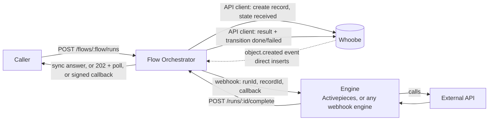

# Flow Orchestrator: an optional enterprise app for request / reply flows

*Date: 2026-10-16. Status: **proposal; owner's decisions recorded in section 12** (nothing implemented). Builds on
[data-objects-automations.md](../datamodel/data-objects-automations.md) (object events) and respects
[why-no-custom-automation-engine.md](why-no-custom-automation-engine.md) (no engine inside Whoobe).*

> **Position of 2026-10-16 (owner), which replaces any "first engine" or "n8n excluded" wording below.** Whoobe distributes **no engine** and prefers none.
> Anyone who wants automations or object events needs an engine of their own choice (Activepieces, n8n, Make, a script: anything that takes a
> webhook); installing it, reaching it from the Gateway and respecting its licence are that person's responsibility. Activepieces was used in the tests
> only for convenience, to avoid building another gateway; the Gateway is a pass-through that keeps no state and no runs.
> **Consequence to settle before building this app:** it is the only part of the proposal that **keeps state** (runs, correlation, callbacks, replies). If Whoobe
> stays a pass-through, the app is what an operator would otherwise add next to their engine; the open point is whether Whoobe ships it at all
> (as an optional app, as proposed) or documents the pattern for the engine to implement. Section 12 stays as recorded; this is a question for the owner.

## 0. The need

A typical enterprise flow:

1. a record is inserted (UI, import, or a call to the API);
2. the record has to be processed;
3. the result triggers a call to an **external API**;
4. the external API answers;
5. Whoobe processes the answer and **sends a payload back to the original caller**.

Object events (the other proposal) cover steps 1 to 2 and are **one way**: the response body of the engine is deliberately not stored.
Step 5, giving the *original caller* an answer, needs something that remembers who asked, correlates the answer and chooses how to
reply. The caller must be able to choose, per request, between a **synchronous** answer (the connection stays open) and an
**asynchronous** one (polling or a signed callback).

## 1. Decision in one paragraph

A separate, **optional app** (`apps/flow-orchestrator`, own container, own database, compose profile off by default) manages **runs**:
it receives the request, creates the Whoobe record through a scoped API client, hands the work to an external engine through one
webhook, waits for the engine's completion call, writes the result on the record as a workflow transition and replies to the caller
in the mode the caller asked for. It executes **no steps of its own**. The core of Whoobe does not change, except for the object events
already proposed (needed only for records inserted directly in Whoobe).

## 2. What it is not

- **Not a workflow engine.** One step only: call the engine's webhook. No branches, waits, loops, transformations, connectors, editor.
  If a request for "a second step" arrives, the answer is "put it in the engine".
- **Not a second source of truth.** The record in Whoobe (and its workflow state) is the truth; the run is a delivery and correlation
  record. If they disagree the record wins and the run is reconciled.
- **Not in the core.** No code of the app runs inside core-api or the gateway; it talks to Whoobe only over HTTPS with an API client.

## 3. Architecture

### Two ways in

| Entry | Who creates the record | Core change |
|---|---|---|
| **Via the app** (`POST /flows/:flow/runs`) | the app, with its API client | none |
| **Via Whoobe** (UI, import, any API write) | Whoobe; an `object.created` event reaches the app's webhook receiver, which opens a run | the object events outbox (phase 0 of the other proposal) |

A direct insert has no waiting caller (the write to Whoobe returns as soon as the record is stored), so only the asynchronous modes
(callback to a URL stored on the record, or nothing) make sense there. **Decision: the entry via events is part of the first version**
(it is how external callers reach Whoobe today), so the object events outbox is a dependency of phase 0.
A stop-gap without the core change is to poll the API by `updatedAt`; it works but has no actor, so no loop guard. Not recommended beyond a trial.

**Synchronous replies need the caller to talk to the app, directly or through the Gateway.** For callers that already come in through a
Gateway route (token verified against the external IDM), the route forwards to the app's `POST /flows/:flow/runs` with a service key and
the verified identity (subject, scopes) in headers; the app trusts the Gateway, never the raw token. That keeps one place that knows the
IDM and gives those callers both modes. Callers that write straight to the Whoobe API get the asynchronous modes only.

### Run states

`received → dispatched → completed | failed | expired`. The same words are used as the **class workflow** of the record
(`received → processing → done | failed`), so every change is in `workflow_transition_log` and visible in the dashboard.

## 4. Reply modes (chosen per request)

| Mode | Request | Behaviour |
|---|---|---|
| **Synchronous** | `mode=sync` and `timeout=20` (seconds, capped by the flow's maximum, default 30) | The app holds the connection until the run ends and answers `200` with the result (or `4xx/5xx` with the error). On timeout it **does not fail**: it answers `202` with `Location: /runs/:id`, so the caller continues as in the asynchronous mode. |
| **Asynchronous, polling** | default | `202 {runId, status, links}`; the caller polls `GET /runs/:id` (`ETag` / `Retry-After` supported). |
| **Asynchronous, callback** | `callbackUrl` (+ the secret is a per-flow or per-client setting, never in the request) | At the end the app POSTs the result, signed (`X-Flow-Signature: sha256=` over `timestamp + "." + body`, `X-Flow-Timestamp`), with retry and backoff (1 min, 5 min, 30 min, 2 h, 12 h), then `dead`, visible and retryable. |

Polling and callback can be used together on the same run. A flow can restrict the allowed modes and set the default.

> **Limit to keep in mind: the synchronous wait is capped at 300 s** (operator setting, default per flow 30 s). Above it the answer is
> always `202` and the caller follows the run. nginx and Gateway timeouts must be raised to match for any flow that uses more than 60 s.

**Slow services (over a minute).** Some enterprise back ends take longer than a minute and cannot be changed. The wait limit is therefore a
**per-flow setting** (`maxTimeoutSec`, default 30, hard ceiling set by the operator, e.g. 300), not a constant. Holding a connection that
long is fragile, so the page says so and the defaults protect the caller:

- every hop in front of the app must allow it: nginx `proxy_read_timeout` for the app's location (the workspace templates keep the default
  60 s, so the flow's value needs a matching setting), the Gateway route timeout, and the caller's own client;
- a request above what the hop allows is cut by that hop, not by the app; the run keeps going, and the caller finds it with `GET /runs/:id`
  (the `Idempotency-Key` makes the retry of the POST safe, it returns the same run);
- `Prefer: wait=<seconds>` (RFC 7240) is accepted as an alias of `mode=sync&timeout=`; `Preference-Applied` says what was honoured;
- the recommendation for such a flow is the **asynchronous** mode with a callback, and `defaultMode: async` with `allowedModes` including
  sync only for callers that know their own timeouts;
- the **engine-side** timeout (`runTtlSec`) is independent of the caller's: a slow service is not a failed run until `runTtlSec` expires.

### Idempotency and correlation

- `Idempotency-Key` header: a second request with the same key (per flow and client) returns the same run, never a second record.
- The `runId` goes to the engine; the engine passes **its own idempotency key to the external API** (the run id is a good one), because
  every hop here is at-least-once.
- `completed` is accepted once; later completion calls with the same `runId` return the stored result (so an engine retry is safe).

## 5. API (draft)

Caller side (authenticated with an API client / key of the flow):

| Call | Purpose |
|---|---|
| `POST /flows/:flow/runs` | start a run; body `{ input, callbackUrl? }`; query `mode`, `timeout`; header `Idempotency-Key` |
| `GET /runs/:id` | state and, when finished, the result or the error |
| `POST /runs/:id/cancel` | mark `expired` (the engine is told, best effort) |

Engine side (authenticated with a **different** key, scoped to `runs:complete`):

| Call | Purpose |
|---|---|
| `POST /runs/:id/complete` | `{ status: "ok" \| "error", result?, error? }` |
| `POST /runs/:id/progress` | optional `{ message, percent }`, shown on the run, never forwarded as the result |

Admin side: CRUD of **flow definitions** and a run / delivery log (list, filter by status, retry a dead callback, cancel).

Flow definition (one row per flow): `slug`, `classId` (the class of the record, optional: a flow can run without creating one),
`engine` (Gateway endpoint and route, or a URL), `allowedModes`, `defaultMode`, `maxTimeoutSec`, `runTtlSec`,
`replyWhen` (`completed` | `created`), `responseShape` (`outcome` | `fields`), `payloadMode` towards the engine (`record` as stored | `minimal`),
`resultFields[]` (which attributes of the record, or which keys of the engine's `result`, may be returned: an **allow-list**),
`callbackSecret` (reference, not value), `enabled`.

## 6. Data of the app

Own PostgreSQL schema (a separate database or a separate schema on the instance's server; **never** the Whoobe tables).

| Table | Content |
|---|---|
| `flows` | flow definitions as above |
| `runs` | `id`, `flowId`, `recordId`, `status`, `idempotencyKey`, `callerId`, `mode`, `callbackUrl`, `input` (kept only as long as `runTtl`), `result`, `error`, `createdAt`, `dispatchedAt`, `finishedAt`, `expiresAt` |
| `dispatches` | attempts to call the engine: time, status, error text (no response body) |
| `callbacks` | attempts to call the caller's `callbackUrl`: time, status, attempts, next attempt, state `pending / delivered / retrying / dead` |

Retention: finished runs 30 days, dead callbacks 90 (configurable); `input` and `result` are cleared first. Personal data in `input` is
the customer's data: the flow definition says whether it is stored at all (`storeInput`, default **off**: only the record has it).

## 7. How a synchronous wait works

The app is stateless between requests except for the database. A waiting request subscribes to the run (PostgreSQL `LISTEN/NOTIFY` on
`run:<id>`, with a poll every 2 s as a safety net, because a notification is not durable). When `complete` arrives, the app writes the
result, commits, notifies; whichever instance holds the connection answers. A cap on **concurrent waiting requests** (default 100) and
a per-client cap protect the process; above them the app answers `202` immediately (the asynchronous mode), not `503`.

## 8. Security

- **Credentials**: the app holds one Whoobe API client with only the scopes it needs (create / update the records of the flow's classes,
  workflow transition). The engine's credentials and the external API's stay in the engine (or the Gateway); the app never sees them.
- **Two keys, two directions**: callers cannot call `/complete`; the engine cannot start runs.
- **Caller identity**: the app does not verify IDM tokens itself. The Gateway already does (external IDM); it forwards the verified subject
  and scopes with a service key, and the app records them on the run (`callerId`) and checks the flow's required scope. Direct API
  callers use their API client key. A flow can require one of the two.
- **Callback authentication** (both supported, chosen per flow): **HMAC** signature with a per-flow secret (default), or **OAuth 2.0
  client credentials** towards the caller's service (token endpoint, client id and secret held as references, token cached until it
  expires, one refresh on `401`). The token endpoint goes through the same outbound guard as the callback URL.
- **SSRF on `callbackUrl`**: HTTPS only, no loopback / private / link-local / metadata addresses (checked on every connection after DNS
  resolution, redirects not followed), optional per-flow allow-list of hosts. The app is outside the Gateway, so this module is its own
  (reuse the code of `safeFetch` as a shared package rather than copying it).
- **Output allow-list**: only `resultFields` leave; nothing from the engine's answer is passed through unfiltered. Response bodies from the
  caller's callback URL are not stored.
- **Signatures** both ways: the app signs callbacks and the engine's webhook; it verifies the engine's completion calls by key.
- **Limits**: body size, rate limit per client, per-flow concurrency cap, run TTL, kill switch `FLOWS_ENABLED=0`.
- **Public sandbox**: the app is not part of it (the profile is off; if mounted, it answers 403 under `SANDBOX_MODE`).
- **Tenancy**: one app per Whoobe instance (one workspace per organisation); the API client and the flows belong to that instance.
- **Audit**: who started which run, from where; every record change by the app goes through the workflow log with the app's actor.
- Security suite: new routes in the route inventory, tests for key separation, SSRF refusals, the allow-list, idempotency, timeout
  degrading to `202`, the signature and the replay window.

## 9. Operating it

- Health: `GET /health` with the oldest `dispatched` run age, the number of waiting requests and of dead callbacks.
- Metrics (counts by status, durations p50 / p95 of the engine, callback success rate).
- A run stuck in `dispatched` beyond `runTtl` becomes `expired` and the record goes to `failed` with a clear message, so a caller polling
  never waits forever.
- Engine down: dispatch is retried (backoff, bounded); after the last attempt the run is `failed` (the caller sees it).
- A circuit breaker per flow after N consecutive engine failures (the flow answers `503` fast and says why).

## 10. Where it would live

| Piece | Place |
|---|---|
| App | `apps/flows` (Node, same stack as the gateway), own `Dockerfile`, own migrations |
| Shared outbound guard | extract from the gateway into a package (e.g. `packages/outbound-guard`), used by both |
| Compose | profile `flows` in the workspace compose, off by default; the engine stays in `docker-compose.automation.yml` or the customer's own |
| Dashboard | *Integrations > Flows*: definitions, run log, callbacks; shown only when the app is installed |
| Docs | an administrators' page in `docs/release`, with a worked example (an Activepieces flow with a webhook trigger and a final HTTP step that calls `/complete`; "respond to webhook" is not needed) |
| Core | none, except the object events outbox for direct inserts |

Packaging as an enterprise add-on (licence, distribution) is a commercial decision, outside this page; technically it is an independent
image, so any model works.

## 11. Phases

| Phase | Content | Size (a guess) |
|---|---|---|
| 0 Spike | object events outbox in the core (created and transitioned, webhook transport; see the other proposal), app skeleton, `flows` + `runs`, entry via events, dispatch to **Activepieces** (n8n is not used: its licence is a problem for this product), `/complete`, the result written through the API client, polling | M |
| 1 | entry via the app / Gateway route with identity forwarding, synchronous mode with the `202` fallback and per-flow limits, callbacks (HMAC and OAuth client credentials) with retry, idempotency, allow-lists, SSRF module shared with the gateway | M |
| 2 | dashboard (definitions, run log, retry), health and metrics, expiry, circuit breaker, nginx / Gateway timeout settings for slow flows, security suite and DAST | M |
| 3 | reconciliation of record state and run, docs and compose profile | S to M |
| 4 | optional: several engines per flow, per-client quotas, Activepieces recipe | decided later |

The spike should end with the owner's flow: an external call inserts a record, an event starts a run, Activepieces calls an external API with the
processed data and calls `/complete`, and the caller gets the result by polling or callback. Phase 1 adds the synchronous answer, for
which the caller must come through the app or a Gateway route.

## 12. Decisions of the owner (2026-10-16) and what is still open

| # | Question | Decision |
|---|---|---|
| 1 | One app or part of the gateway | **Separate app.** |
| 2 | Maximum synchronous wait | 30 s default, but **configurable per flow** (cap set by the operator): some enterprise services take over a minute. See "Slow services" in section 4. |
| 3 | Payload to the caller | Normally simple, shaped by the kind of answer: the **allow-listed result** of the flow (`resultFields`, or the engine's `result`). Nothing beyond it. |
| 4 | Store `input` in the run | **Off by default** (`storeInput`). |
| 5 | Entry | **Via events** (calls from outside write to Whoobe): in the first version, so the core outbox is a dependency of phase 0. The Gateway-route entry follows in phase 1 (it is what allows a synchronous answer). |
| 6 | Callback authentication | **Both**: HMAC and OAuth client credentials, per flow. Inbound tokens are verified by the **Gateway** (external IDM) and forwarded as an identity. |
| 7 | Engine contract | **The engine calls `/complete`.** |
| 8 | Exactly-once, payments | **Out of scope**; payment-like flows use the external services the Gateway already supports. At-least-once with idempotency keys. |
| 9 | Licence | **Open.** Customisations for a customer are not included. |

Confirmed later the same day:

| # | Question | Decision |
|---|---|---|
| 11 | Gateway forwarding to the app | **OK**: a small change in the Gateway (route forwards with a service key and the verified identity). |
| 12 | Hard ceiling of the synchronous wait | **300 s is fine** and is shown prominently (see the callout in section 4 and the flow editor). |

| 13 | HTTP status of a failed run (flow A) | **`502`** with the body `{ "success": false, "error": "…" }`. |

Nothing is left open: the first spike can start.

### 12.1 First flows (the ones that drive the spike)

**Flow A, "forward and confirm"**
1. The caller inserts a record (event entry) or posts it to the app (Gateway entry).
2. The app forwards the record **unchanged** to the engine (no processing in Whoobe, `payloadMode: record`).
3. The engine sends it to the external system and calls `/complete`.
4. The reply to the caller has a **fixed shape**, built by the app from the run's outcome, not copied from the engine:
   - success: `200` and `{ "success": true }`
   - error: `502` and `{ "success": false, "error": "<message>" }` (for a polled run: `GET /runs/:id` answers `200` with the run, whose
     `result` carries this body and `httpStatus: 502`; in a callback the status is in the signed envelope); the message is the engine's `error` string, **cut to 500 characters, text only**
     (no stack, URLs with credentials or engine internals; the full text stays in the run log).
   The caller can read it by polling, as a callback body, or as the synchronous answer, identically.

**Flow B, "acknowledge with an identifier"**
1. The caller inserts a record.
2. The reply carries the **record id** (or another stored field named in `resultFields`), e.g. `{ "id": "…" }`.
3. The engine may still be dispatched afterwards, or not at all.

This needs a flow option, `replyWhen`: `completed` (flow A: wait for the engine) or `created` (flow B: the run is `completed` as soon as the
record is stored, the answer does not wait for the engine; dispatch, if configured, continues in the background and its failure shows in
the run log and on the record's workflow state, not in the answer already given). With `replyWhen: created` the synchronous mode is
immediate and the 300 s ceiling is irrelevant.

Response shapes are two built-in ones, no template language: **`outcome`** (`success` / `error`, flow A) and **`fields`** (the allow-listed
attributes of the record, flow B). Both go through the allow-list rule of section 8.

Name (left to the author, 2026-10-16): the product is **Whoobe Flows** (dashboard section *Integrations > Flows*, kill switch
`FLOWS_ENABLED`, compose profile `flows`), the app directory is `apps/flows`. "Flow Orchestrator" in this page's title and file name is
the working name and stays only so that links do not break. It says what the user sees (a flow with a run log) and does not promise an engine.

## 13. Risks

| Risk | Mitigation |
|---|---|
| The app grows into an engine | one step by design; a written rule and a review question for every feature request |
| Two truths (record and run) | the record wins; reconciliation job; same state names; every change through the workflow log |
| Held connections exhaust the process | cap on waiting requests, fall back to `202`, per-client caps |
| A caller polls forever | `runTtl` and `expired` / `failed` states written on the record |
| SSRF through `callbackUrl` | shared outbound guard, HTTPS, no private ranges, no redirects, optional allow-list |
| Data leaves by mistake | `resultFields` allow-list, `storeInput` off, no response bodies stored |
| Engine retries create duplicates | `runId` as the idempotency key towards the external API; `/complete` is idempotent |
| Loop (the app's write fires an event that starts a run) | the app's client is in `ignoreActors` of its own subscription; the run is created only from `created` of flows' classes |
