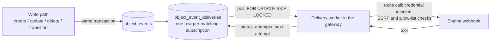

# Data Objects Automations: events for an external engine

*Date: 2026-10-15. Status: **proposal, for the owner's review** (nothing implemented). Follows
[why-no-custom-automation-engine.md](../automations/why-no-custom-automation-engine.md) and reuses what
[marketing-automation-plan.md](../automations/marketing-automation-plan.md) already built for forms.*

## 0. The question

> When a data object is created or updated, it should be possible to start some sort of automation. We do not want to build an
> automation engine, so we have to evaluate whether an automation needs an external service or lives inside the Whoobe perimeter
> (the data does not need to leave Whoobe).

This page answers with one mechanism, **object events delivered to an external engine**, plus a short list of what stays inside Whoobe
as plain configuration, and says what we deliberately do *not* build (code that runs inside Whoobe: controllers, listeners, plugins).

## 1. Decision in one paragraph

Whoobe emits a small, signed **event** when a data object changes (created, updated, published, unpublished, deleted, workflow
transition). An **event subscription** (an administrator configures it) says which events of which class go to which **Gateway
endpoint and route**; the engine behind that endpoint (n8n, Activepieces, or any HTTP webhook) does the work. Delivery is durable
(a *transactional outbox*), at-least-once, retried with backoff, visible in a delivery log and stoppable by a kill switch. No customer
code runs inside Whoobe.

## 2. What is inside the perimeter, what is not

| Need | Where it lives | How |
|---|---|---|
| Keep a value valid (required, unique, format) | Whoobe | Class field options (exist: *mandatory*, *unique*) |
| Who may move an object to which state | Whoobe | Class workflow (exists: states, transitions, `objects:publish`) |
| Derive a value from another (slug from title) | Whoobe | Field behaviour (urlSlug *Generate* exists); more only as declared, tested field types |
| Anything that **calls another system** (CRM, mail, ERP, chat, a build) | External engine | **Object events** (this page) |
| Anything that must run **code of the customer** | The customer's own service | It receives the event over HTTPS and calls Whoobe back with an API client (scoped key) |
| Block or rewrite a save **before** it happens | Not covered | See section 11 (synchronous hooks): a separate decision |

The rule of thumb for the owner's "does the data leave Whoobe?" question: if the work only needs the object itself, it is a class
rule; if it needs a second system, the object (or a reduced copy) must leave anyway, and then the only open design question is how
to make that safe, which is what the rest of this page does.

## 3. Why not listeners / controllers / plugins inside Whoobe

- **No real sandbox in Node.** `vm` is not a security boundary; real isolation means separate processes or isolates, a capability model
  and resource limits: a product of its own.
- **A promise nobody can keep for long.** In-process extension code needs a stable internal API. Every release would risk breaking other
  people's plugins, and every incident would start with "is it the product or the plugin?".
- **It contradicts the decision already taken** (Whoobe is the trigger and the reaction surface, the engine is external).
- **What exists is enough for operator-level code**: Gateway *plugins* are code added by the operator on the server and loaded at start-up,
  trusted like a patch of the product, never uploaded from the UI. They stay as they are and are not extended to data objects.

## 4. Events

Emitted **after** the change is stored, one per locale row (a record with two locales emits two events, both carrying the
`translationGroupId`).

| Type | When |
|---|---|
| `object.created` | a row is inserted |
| `object.updated` | attributes, key, path or parent changed (not for a pure publish / unpublish) |
| `object.published` | `published` goes false to true |
| `object.unpublished` | `published` goes true to false |
| `object.deleted` | a row is deleted |
| `object.transitioned` | the workflow state changed (`from`, `to`) |
| `object.bulk` | **one summary** for an import / "Empty data" / migration run (class, kind, count, first ids), never one event per row |

**Bulk is a deliberate exception.** A Pimcore migration or a CSV import writes thousands of rows; one event per row would flood the engine
and the outbox. The write paths that are bulk by nature (`bulkImportDataObjects`, `upsertDataObjectByPimcoreId`,
`deleteDataObjectsByClassId`, the migration tool) emit the single `object.bulk` event, or none when the subscription does not ask for it.

### Payload

```json
{
  "id": "6f1c…",                       // event id: the idempotency key for the consumer
  "type": "object.updated",
  "occurredAt": "2026-10-15T09:12:30Z",
  "instance": "dashboard.whoobe.dev",
  "class": { "id": "…", "name": "Blog" },
  "object": { "id": "…", "translationGroupId": "…", "locale": "en", "key": "…", "published": true, "workflowState": null, "updatedAt": "…" },
  "changed": ["title", "tags"],        // field names only
  "attributes": { "title": "…" },      // only in mode "fields", only the fields the subscription allows
  "actor": { "type": "user | api-client | system | import", "id": "…" }
}
```

Modes per subscription: **minimal** (default: ids, state, `changed`; the engine reads the rest through the API if it needs it) and
**fields** (an explicit allow-list of attribute names is sent). Asset fields travel as references, never as bytes. Nothing is sent that
the administrator did not list: no hidden fields, no previous values (a later option).

## 5. Subscriptions

One row per subscription (`object_event_subscriptions`):

| Field | Meaning |
|---|---|
| `name`, `enabled` | label and pause switch |
| `classId` | one class, or empty for all classes |
| `events[]` | the types above |
| `endpointId`, `routeId` | the Gateway endpoint and route to call (credentials, base URL checks and rate limit are the Gateway's) |
| `payloadMode`, `fields[]` | minimal or fields, and the allow-list |
| `ignoreActors[]` | e.g. the API client that the engine itself uses to write back (loop guard, see 8) |
| `signingSecret` | optional HMAC key: header `X-Whoobe-Signature: sha256=…` over `timestamp + "." + body`, `X-Whoobe-Timestamp` |

Configured under *Integrations* next to endpoints and presets, by users with a new permission `object-events:manage` (granted to `admin`
only). Never configurable in the public sandbox (see 9).

## 6. Delivery: transactional outbox, at-least-once



- The event row is written **in the same transaction** as the data change, so a change and its event exist together or not at all (today
  the write functions do not open a transaction; wrapping create / update / delete is part of phase 0).
- The worker lives in the **gateway**, which already owns endpoints, credentials, SSRF checks and the outbound allow-list and reads the same
  PostgreSQL; the core-api never calls out to third parties. One worker per instance, with a concurrency cap.
- States: `pending`, `delivered`, `retrying`, `dead`. Backoff 1 min, 5 min, 30 min, 2 h, 12 h; after the last attempt the delivery is
  `dead` and stays visible. Timeout 10 s per call. Success is any 2xx; the **response body is not stored** (only status and a truncated
  error text), so nothing a third party answers can reach the database or a page.
- **At-least-once**: the consumer must treat `id` as an idempotency key. Order is best effort per object (`occurredAt`, the object's
  `updatedAt`); there is no global order.
- Optional **coalescing** per subscription (e.g. 5 s): several updates of one object in the window become one `object.updated`. Useful with
  editing in the table cells and with autosave; off by default.
- Retention: delivered rows 14 days, dead rows 90 days (configurable); a nightly clean-up.

### Transports

The outbox and the worker do not depend on how the event is carried. Two transports, chosen per subscription:

| Transport | What it is | When |
|---|---|---|
| `webhook` (default) | HTTPS POST through a Gateway endpoint and route, as described above | Any engine or service that exposes a URL; per-delivery log, status and retry |
| `mqtt` (optional) | The worker publishes the event, QoS 1, to a broker topic such as `whoobe/<workspace>/objects/<class>/<event>`; subscribers (n8n, Node-RED, Home Assistant, the owner's existing clients) connect **to the broker** | Several consumers of the same event, consumers behind NAT or on a laptop, existing MQTT tooling |

MQTT notes:

- The outbox stays: committing the data and publishing to the broker are not atomic, and the broker can be down. The worker publishes
  from the outbox and marks the delivery `delivered` when the broker acknowledges (PUBACK). That is "accepted by the broker", not "processed
  by a subscriber"; the per-subscriber delivery log of the webhook transport does not exist here.
- A subscriber that is offline receives the events it missed only with a persistent session (clean session off) and QoS 1; the queue is
  the broker's. Retention and size limits are broker settings.
- Access control is the broker's (users, TLS, ACL per topic prefix). The broker address is set by the administrator and goes through the
  same outbound checks as an endpoint host.
- The broker is one more component to run. Proposed as an **optional Compose profile** (Mosquitto), off by default. Open: one broker per
  workspace, or a shared one with a prefix per workspace and ACLs.
- Payload, signature, actor, rate cap, circuit breaker and sandbox block are the same as for the webhook.

### Alternative considered: PostgreSQL triggers

A trigger on the object table would write the outbox row for every writer (imports, SQL scripts, restores) in the same transaction, with
no need to wrap the write functions. Not the main mechanism, because: the trigger sees changed rows, not semantic events (publish,
transition); it does not know the actor unless every transaction runs `SET LOCAL` with it, which the loop guard needs; row triggers turn
an import into one event per row (the bulk summary would need statement triggers with transition tables); building an allow-listed
payload in plpgsql is fragile; the sandbox reset, seeds and restores would fire events unless suppressed; and a bug in a trigger blocks
every object write. Kept for later **only as a safety net**, if the phase 0 inventory finds writers that bypass
`data-objects-records.ts`. `LISTEN/NOTIFY` is not durable (a listener that is down loses the message; payload limit about 8 kB), so it is
not the queue; it may be used as a **wake-up for the worker** (after the outbox insert) instead of polling.

## 7. Operating it

- **Delivery log** per subscription: time, event, status, attempts, last error; **Retry** on a dead delivery, **Send test event**
  (a synthetic `object.updated` marked `"test": true`).
- **Circuit breaker**: after N consecutive failures (default 20) the subscription pauses itself and says so in the list.
- **Kill switches**: `OBJECT_EVENTS_ENABLED=0` stops emitting and delivering for the instance; each subscription has its pause switch.
- **Rate cap** per subscription (default 600 per minute); above it deliveries wait, they are not dropped.
- `GET /health` of the gateway reports the oldest pending delivery age, so a stuck queue shows up in monitoring.

## 8. Loops

An engine that writes back into Whoobe (for example it sets `status = synced`) fires another event, which starts the flow again.
Three guards, all explicit:

1. Every event carries the **actor**. A subscription can list `ignoreActors` (default: it suggests the API client chosen for that
   engine), so the engine's own writes do not trigger it.
2. The rate cap and the circuit breaker (section 7) end a runaway loop in minutes, not hours.
3. The delivery log shows the actor, so a loop is recognisable at a glance.

## 9. Security

- **Credentials never leave the Gateway**: the subscription points at an endpoint and a route; keys and tokens stay where they are.
- Reuses the Gateway's checks: base-URL rules, SSRF defences (`safeFetch`), the outbound allow-list (`OUTBOUND_ALLOW_HOSTS` and the
  `OUTBOUND_ALLOW_PRIVATE` switch), HTTPS by default.
- **Data minimisation**: minimal payload by default, explicit field allow-list otherwise. The class's *hidden fields* only hide a field
  from the edit form, they say nothing about confidentiality, so they do not protect it here: see open question 9 (a per-field
  "never leaves Whoobe" flag).
- **Authorisation**: creating or changing a subscription needs `object-events:manage`; the delivery log can show attribute values
  only to users who may read that class.
- **No code, no templates**: the payload shape is fixed, so there is no expression language to inject into.
- **Public sandbox**: disabled like AI and mail (`SANDBOX_MODE`), answers 403.
- The signature lets the engine reject calls that do not come from this instance; the timestamp limits replay (the consumer should
  refuse stamps older than 5 minutes).
- Security suite: new routes in `routes.expected.json`, tests for the permission, the sandbox block, SSRF refusal, the field
  allow-list and the no-body-stored rule; DAST on the new routes.

### Engine on the same instance

An engine (for example Activepieces from `docker-compose.automation.yml`) on the same host talks to Whoobe over the host or a Docker
network, not over the internet, so no traffic needs to leave the machine in either direction.

- **Whoobe to engine**: the Gateway calls the engine's webhook on the internal address. The outbound guard blocks loopback and private
  ranges unless allowed: use `OUTBOUND_ALLOW_HOSTS=<engine host name>` (exempts that one host) rather than `OUTBOUND_ALLOW_PRIVATE`, which
  opens every private address. (Checked against `safeFetch` in phase 0 step 5, with a real receiver: in production a loopback target is refused (`OUTBOUND_ALLOW_LOOPBACK` is false there) and `OUTBOUND_ALLOW_HOSTS=<host>` lets exactly that host through. Note that `OUTBOUND_ALLOW_PRIVATE` defaults to **true**, so private ranges are open unless it is set to false; only loopback is closed in production by default.)
- **Network**: the sample compose file is a separate project with its port bound to `127.0.0.1` of the host, which the workspace
  containers cannot reach through their own loopback. Either attach the engine to the workspace network (or a shared external network)
  and use the service name, or use `host.docker.internal`.
- **Engine to Whoobe**: the engine calls the Gateway or the API on the internal address with its own scoped API client, which is the client
  listed in `ignoreActors`.
- Internal traffic is not encrypted: keep the signature and the secret on the webhook, keep the network private to the two projects, and
  put the engine's own UI behind HTTPS if it is ever exposed.

## 10. Where it touches the code

| Piece | Place |
|---|---|
| Tables, migration | `packages/core/src/db/` (object events, deliveries, subscriptions), a numbered migration |
| Emit | the data-object write functions in `packages/core/src/db/data-objects-records.ts`, which already call `indexObject` after each write; `createDataObject`, `updateDataObject`, `deleteDataObject`, the bulk and Pimcore upsert paths, the workflow transition route and the batch action route of core-api |
| Payload and diff | a pure module (`object-events.ts`) next to them: builds the payload, computes `changed`, picks the allow-listed fields |
| Subscriptions API | core-api routes `/object-event-subscriptions` (CRUD, test event, retry), permission `object-events:manage` |
| Worker | `apps/gateway/src/object-event-worker.ts`, calls the existing route-execution code with the endpoint's credentials |
| UI | *Integrations > Object events*: list, editor, delivery log; the **Automations** panel gains a section for subscriptions next to the forms |
| Docs | `communication/` page for administrators; this page moves to `docs/release` when implemented |

Every write function listed is a single choke point per operation, which is what makes this feasible without touching each caller.
The workflow transition and batch routes are to be confirmed in phase 0 (they update through the same functions, but that must be
checked, not assumed).

## 11. Not in this proposal: synchronous hooks

A webhook cannot stop a save or change a value before it is written. If that is ever needed, the order of preference is:

1. **Declarative rules** in the class (required, unique, pattern, number range, "published needs field X"); some exist, more are cheap.
2. **One validation webhook** (`object.before-publish`), called with a short timeout (2 s), allowed only to answer *allow* or *refuse with a
   message*, never to modify data, failing open or closed by a setting.
3. A real extension API only if a frequent, concrete request cannot be met by 1 and 2. Not planned.

## 12. Phases

| Phase | Content | Size (a guess, to be revised after the spike) |
|---|---|---|
| 0 Spike | outbox tables, emit from create / update / delete, worker with retry, subscriptions via the API only, one real engine (Activepieces; n8n is excluded by its licence) | S to M |
| 1 | UI (list, editor, delivery log, test event, retry), permission, sandbox block, docs | M |
| 2 | publish / transition events, bulk summary, field allow-list, coalescing, loop guard, circuit breaker, health | M |
| 3 | optional: previous values, per-class defaults, validation webhook (section 11) | decided later |

Phase 0 should end with the owner's own flow running: a Blog post is published and an Activepieces flow posts it to a channel or rebuilds a
site, with the engine idempotent on `id`.

## 13. Open questions for the owner

1. **Worker location**: gateway (proposed, it owns credentials and SSRF checks) or core-api calling the gateway with a service token?
2. **Default payload**: minimal (proposed) or fields? Minimal costs the engine one extra read, but leaks nothing by mistake.
3. **Bulk events**: one summary (proposed), none, or per-row on request for small imports?
4. **Retention** of delivery logs (14 / 90 days proposed) and whether dead deliveries should also raise a notification.
5. **Pages**: the same mechanism for pages and snippets (`page.published`) later? The outbox does not depend on the object model.
6. **Previous values** in `object.updated`: needed by some flows (price changed from X to Y); costs a read before every write.
7. Do we want the **synchronous validation webhook** at all, or are declarative class rules enough?
8. Is **at-least-once** acceptable for every flow the owner has in mind, or is a case that needs exactly-once (payments) in scope? It
   would not be solved here: the consumer has to be idempotent.
9. Should a class field be markable as **"never leaves Whoobe"** (passwords, personal data), refused in every allow-list? Cheap to add, and the
   safe default for new sensitive field types.
10. **Transport**: webhook only for the first version (proposed, enough for an engine on the same instance), or MQTT from the start? If
    MQTT: one broker per workspace or a shared one with a topic prefix and ACLs?
11. **Triggers**: is a PostgreSQL trigger acceptable as a later safety net for writers that bypass the write functions (see "Alternative
    considered")?

## 14. Risks

| Risk | Mitigation |
|---|---|
| Event flood from an import or a script | bulk summary, rate cap, coalescing, circuit breaker |
| Loop engine to Whoobe to engine | actor in the event, `ignoreActors`, rate cap |
| Data leaves by mistake | minimal by default, explicit allow-list, hidden fields refused |
| A slow or down engine fills the queue | per-subscription pause, backoff, dead state, oldest-pending metric in health |
| Write path forgets to emit | a unit test that lists the write functions and fails on a new one without an event, plus the phase 0 inventory |
| Transactions added to the write functions change behaviour | cover with the existing API tests before touching them |
