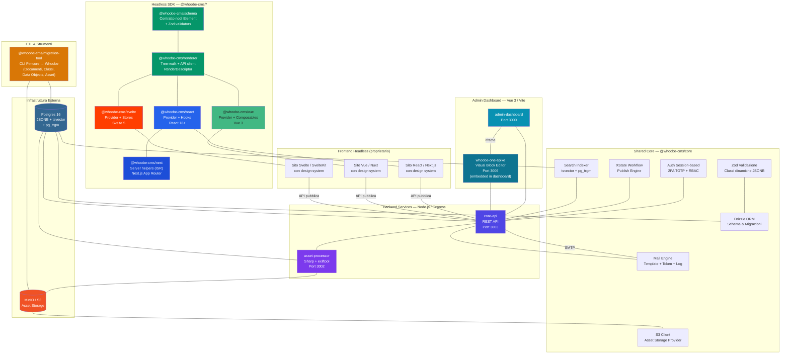

------------------------------
## Proposta Tecnica: Whoobe CMS - PIM, DAM e Headless CMS

## 1. Executive Summary
L'attuale panorama tecnologico dei nostri progetti è frammentato tra WordPress (per siti editoriali minori), Strapi / Contentful (per applicazioni headless) e Pimcore (per la gestione complessa dei dati aziendali e PIM). Questa frammentazione genera:

* Elevato debito tecnico e manutenzione di stack differenti (PHP/Symfony vs Node/JavaScript).
* Costi SaaS crescenti ed eccessivi vincoli sulle API (Contentful).
* Difficoltà di integrazione nativa tra la modellazione dei dati strutturati (PIM) e l'esperienza di editing visuale (CMS).

Whoobe CMS viene proposto come un'unica piattaforma open-source e TypeScript-native in grado di unificare PIM, DAM e Headless CMS, riducendo l'infrastruttura e standardizzando lo sviluppo sul linguaggio di riferimento del team.

------------------------------
## 2. Analisi Comparativa degli Stack comunement utilizzati vs Whoobe CMS

| Feature | WordPress | Strapi / Contentful | Pimcore | Whoobe CMS |
|---|---|---|---|---|
| **Tecnologia** | PHP (Legacy) | Node.js / SaaS | PHP / Symfony | TypeScript Native |
| **Data Modeling** | Rigido / PostMeta | Relazionale / API-first | Classi PHP dinamiche | Dinamico su Postgres JSONB |
| **Search Engine** | Query SQL LIKE | Add-on (Algolia/Meili) | Elasticsearch/Solr (Pesante) | Nativo (FTS + pg_trgm) |
| **Page Building** | Gutenberg (Accoppiato) | Assente / Limitato | Rigido (Aree Documenti) | Visual Block Builder (Zod JSON) |
| **Costo / Lock-in** | Open (Ma alto debito) | Vendor Lock-in / Limiti API | Open (Ma costo infrastruttura) | Open-source (Controllo Totale) |

------------------------------
## 3. Deep Dive Architetturale (I Pilastri di Whoobe)

Whoobe CMS è costruito come **monorepo TypeScript** (pnpm + Turborepo) con un core condiviso, servizi backend specializzati, un'applicazione admin dashboard, un visual builder standalone e un SDK headless multi-framework. L'architettura segue il principio **"core comune, adapter intercambiabili"** — lo stesso motore di validazione, ricerca e rendering alimenta sia l'editor admin che i siti frontend pubblici, senza duplicazione di logica.

### Diagramma architetturale semplificato (per dominio)

```mermaid
flowchart LR
    subgraph PIM["DOMINIO PIM/MDM"]
        direction TB
        CLASSI["Classi Dinamiche<br/>(Zod + JSONB)"]
        OGGETTI["Data Objects<br/>Traduzioni, Locales"]
        COMPONENTI["Componenti<br/>Sottoschemi riutilizzabili"]
    end

    subgraph DAM["DOMINIO DAM"]
        direction TB
        ASSET["Asset Digitali<br/>File, Versioni, Metadati"]
        THUMB["Thumbnail<br/>Sharp Presets"]
        S3STORE["Storage S3/MinIO<br/>Public/Private"]
    end

    subgraph CMS["DOMINIO CMS"]
        direction TB
        BUILDER_2["Visual Builder<br/>Drag & drop WYSIWYG"]
        PAGINE["Pagine<br/>SEO, Traduzioni, Workflow"]
        SNIPPET["Snippet riutilizzabili<br/>Slot template"]
        TEMI["Temi & Stili<br/>Colori, Font, CSS"]
        FORM["Forms<br/>Submission → Data Object"]
    end

    subgraph SDK_2["DOMINIO HEADLESS SDK"]
        direction TB
        CONTRATTO["Contratto<br/>@whoobe-cms/schema"]
        CORE_RENDER["Core Renderer<br/>@whoobe-cms/renderer"]
        ADAPTER["Adapter Framework<br/>React / Next / Vue / Svelte"]
    end

    subgraph ETL["DOMINIO ETL"]
        direction TB
        MIGRA["Migrazione Pimcore<br/>CLI + UI integrata"]
    end

    PIM <--> CMS
    DAM <--> CMS
    CMS --> SDK_2
    ETL --> PIM
    ETL --> DAM
    ETL --> CMS
```

### Principio architetturale

Whoobe CMS adotta un'architettura **a strati con core condiviso e adapter intercambiabili**:

| Principio | Descrizione |
|---|---|
| **Single Source of Truth** | Tutti i servizi backend e l'SDK frontend condividono lo stesso schema di dati (Drizzle ORM), la stessa validazione (Zod) e lo stesso motore di trasformazione campi. Un campo "data" configurato nell'admin viene validato, indicizzato, ricercato e renderizzato identicamente ovunque. |
| **Separazione delle responsabilità** | `core-api` serve dati, `asset-processor` gestisce file/media, `admin-dashboard` fornisce l'interfaccia di gestione, `whoobe-one-spike` l'editing visuale. Ogni servizio è indipendente, scalabile e sostituibile. |
| **Headless by design** | Il visual builder produce alberi JSON puri, validati e serializzabili. L'SDK li consuma in qualsiasi framework frontend (React, Next.js, Vue, Svelte) senza dipendenza dal backend di editing. |
| **Zero nuove infrastrutture** | Postgres 16 fa da database, motore di ricerca (tsvector + pg_trgm) e catalogo asset. MinIO/S3 gestisce i file. Nessun cluster Elasticsearch, Redis o servizio SaaS richiesto. |

## 3.1 Modellazione Dati Flessibile tramite Postgres JSONB
A differenza di Pimcore (che genera tabelle/classi PHP a runtime) o di Strapi (che richiede migrazioni SQL per ogni modifica ai campi), Whoobe mappa le Classi di dati dinamiche su colonne Postgres JSONB.

* Vantaggi per il team: Nessuna alterazione dello schema SQL a runtime; modifiche ai campi immediate dall'Admin UI senza downtime; validazione strutturale rigida e sicura garantita a livello applicativo tramite schemi Zod.

## 3.2 Motore di Ricerca Interno a Costo Zero
Invece di costringere il team a configurare e sincronizzare cluster Elasticsearch o Meilisearch, Whoobe sfrutta le funzionalità enterprise avanzate di Postgres:

* tsvector + indici GIN: Ricerca Full-Text indicizzata e fulminea direttamente sui campi estratti dal JSONB.
* pg_trgm (Trigrammi): Supporto nativo per il fuzzy searching (errori di battitura) e type-ahead (completamento automatico) senza uscire dal database primario.

## 3.3 Visual Builder (Whoobe One)
Il visual builder integrato (`whoobe-one-spike`) è un'applicazione Vue 3 standalone embedded nell'admin dashboard che permette la creazione WYSIWYG di pagine e snippet:

* **Block editor visuale**: interfaccia drag & drop con palette di elementi (contenitori, testo, immagini, video, link, bottoni, slider, form, search, mappe, campi dati bindati) e tree della struttura del documento.
* **Output JSON strutturato e validato**: ogni pagina genera un albero Zod-validato di nodi `{ type, element, children, content, css, image, configs, ... }`, archiviato in una colonna JSONB del database.
* **SEO, sitemap e traduzioni**: ogni pagina porta metadati SEO (meta title/description, og:image), impostazioni di ricerca/indexing, stato di pubblicazione (bozza/revisione/pubblicato), traduzioni per locale e pattern di URL dinamici.
* **Temi e stili**: supporto per temi per-sito web con colori nominali e font, ereditati da tutte le pagine e snippet, con override per-pagina.
* **Snippet riutilizzabili**: porzioni di albero salvabili e riutilizzabili in slot di template, testate, sidebar e piè di pagina.
* **Editor template email**: lo stesso motore editor viene usato per comporre template email HTML con preview full-screen.
* **Generazione AI**: integrazione diretta con l'agente LLM per creare pagine e snippet da prompt in linguaggio naturale.

## 3.4 SDK Frontend Headless
Whoobe CMS è completamente headless: il visual builder produce alberi JSON che possono essere renderizzati in qualsiasi framework frontend. L'SDK ufficiale è già implementato per tutti i framework target:

### Architettura a tre strati

| Strato | Package | Descrizione |
|---|---|---|
| **Contratto** | `@whoobe-cms/schema` | Interfacce dei nodi Element, trasformazioni campo (date, numeri, URL), schemi Zod per validazione runtime. Framework-agnostic. |
| **Core Renderer** | `@whoobe-cms/renderer` | Tree-walk, risoluzione dati bindati (da API pubblica), risoluzione immagini DAM, link dinamici via path-pattern, client API tipizzato (`getPage`, `getObject`, `queryObjects`, `search`, `submitForm`), composizione layout di template. Zero dipendenze framework, SSR-safe. |
| **Adapter framework** | react / vue / svelte | Componenti dichiarativi che mappano i `RenderDescriptor` su componenti del design system proprietario. |

### Adapters

| Adapter | Package | Target |
|---|---|---|
| **React** | `@whoobe-cms/react` | React 18+. Provider, WhoobeNode (ricorsivo), WhoobePage, hooks (`usePage`, `useObject`, `useQuery`, `useForm`). |
| **Next.js** | `@whoobe-cms/next` | App Router. Helper server-side: `getPageData` (fetch + walk + compose con ISR tramite `revalidate`), `getObjectData`, `generateMetadataFromPage` (Next Metadata), `staticParamsForSlugs`/`staticParamsForRecords` per pagine dinamiche. Re-esporta l'adapter React. |
| **Vue 3** | `@whoobe-cms/vue` | Vue 3. Provider, WhoobeNode, WhoobePage, composables (`useWhoobe`, `usePage`, `useObject`, `useQuery`, `useForm`). |
| **Svelte 5** | `@whoobe-cms/svelte` | Svelte 5. WhoobeProvider, WhoobeNode, WhoobePage, componenti primitivi (Container, Text, Image, Link, Form, Input, Select, Search…), stores (`createPageStore`, `createObjectStore`, `createQueryStore`). |

### Vantaggi per il team frontend
* **Nessun vendor lock-in**: si può passare da React a Vue o Svelte cambiando solo l'adapter; il core renderer e lo schema restano identici.
* **Design system proprietario**: ogni adapter permette di registrare componenti personalizzati per ogni `NodeKind` (container, text, image, form, search, ecc.), mantenendo il look & feel del brand.
* **SSR/ISR nativo**: l'adapter Next.js sfrutta il fetch nativo di Next per ISR, metadata e static params senza dipendenze aggiuntive.
* **Hydration deterministico**: i `RenderDescriptor` sono serializzabili e passabili oltre il confine SSR, garantendo HTML identico tra server e client.

## 3.5 Siti Web (Multi-site), Template e Temi
Whoobe CMS supporta nativamente la gestione di più siti web dalla stessa installazione, ognuno con template, temi, percorsi URL e lingue propri.

### Multi-site e URL dinamici
* **Siti web multipli**: ogni sito ha lingua predefinita, lingue supportate, e un proprio set di percorsi URL.
* **Pattern URL dinamici**: i percorsi supportano pattern come `/it/news/{slug}` con risoluzione lato server, permettendo URL semanticamente ricchi e SEO-friendly.
* **Pagine pubbliche**: route dedicata `GET /public/pages/:locale/*` che serve pagine pubblicate con risoluzione del template e composizione del layout completo (header, aside, footer, main).

### Website Templates
* **Template per sito**: ogni sito può avere uno o più template con slot configurabili per header, aside e footer.
* **Slot compositi**: ogni slot accetta pagine modulo, snippet riutilizzabili ed elementi JSON personalizzati, compositi nell'ordine definito dall'admin.
* **Override per path pattern**: i template possono essere associati a specifici pattern URL (es. `/it/blog/*` usa un template diverso dal resto del sito), con fallback al template predefinito.
* **Classi e stili per slot**: ogni slot ha className e style CSS personalizzabili direttamente dall'interfaccia admin.

### Temi (Colori e Font)
* **Temi indipendenti**: entità `themes` con nome, mappa colori (nome → hex), font family e CSS opzionali, gestite tramite API CRUD dedicata.
* **Associazione gerarchica**: un tema può essere assegnato a un sito web, a pagine specifiche o a snippet. La gerarchia di risoluzione è: tema pagina → tema sito → lista font predefinita.
* **Override per-pagina**: nell'editor visuale, il modal Theme permette di sovrascrivere colori e font del tema ereditato per la singola pagina.
* **Colori Tailwind a runtime**: i colori nominali del tema vengono iniettati come token `@theme` CSS, riconosciuti da `@tailwindcss/browser` — classi come `bg-brand` funzionano immediatamente nell'editor e nella preview.
* **Caricamento font**: i Google Fonts del tema vengono caricati automaticamente nelle pagine pubbliche e nell'editor tramite `<link>` tags, con fallback a stack web-safe per i client email.

## 3.6 Digital Asset Management (DAM) su MinIO/S3
La gestione degli asset digitali è integrata nativamente con storage S3/MinIO e processamento lato server tramite Sharp:

* Caricamento con generazione automatica di thumbnail, medium e large presets configurabili.
* Estrazione metadati EXIF/IPTC e anteprime per PDF, Office e JSON direttamente nel pannello admin.
* Regole di visibilità public/private per cartelle, versioning degli asset e URL presignati per asset privati.
* Proxy pubblico `/dam-asset/*` che serve gli asset senza scadenza né CORS, indipendentemente dalla visibilità.

## 3.7 Forms & Notifiche Email
I form creati nel page builder inviano i dati a un endpoint pubblico che crea bozze (Data Objects non pubblicati) con protezione anti-spam:

* Honeypot e rate limiting per IP contro abusi.
* Template di posta elettronica riutilizzabili (HTML con editor visuale o testo semplice) con token `{form.field}` per personalizzazione e indirizzi dinamici `to`/`bcc`.
* Log completo della posta inviata con anteprima, reinvio, ricerca, paginazione ed eliminazione bulk.
* Flag "BCC del mittente" per tenere copia di tutte le email in uscita.

## 3.8 Motore di Pubblicazione con Workflow XState
Il flusso di pubblicazione è gestito da un motore a stati basato su XState:

* Stati e transizioni configurabili (bozza, revisione, pubblicato, ecc.).
* Audit log di ogni transizione per tracciare chi ha promosso cosa e quando.
* Publish gate che impedisce sovrascritture accidentali di pagine live durante le migrazioni.

## 3.9 Autenticazione e Permessi
La sicurezza si basa su autenticazione session-based condivisa tra tutti i backend:

* 2FA via TOTP (codice QR, codici di recupero) per accesso amministrativo.
* Permessi basati su ruoli (RBAC) per segregare le operazioni di lettura/scrittura sui vari moduli.

## 3.10 Agente AI Generativo
Un agente LLM integrato (OpenAI / Anthropic / Google / OpenRouter) assiste i content editor:

* Generazione di pagine e snippet direttamente nel visual builder tramite prompt in linguaggio naturale.
* Pannello storico delle generazioni con possibilità di anteprima e re-import nel canvas.
* Alberi JSON generati vengono normalizzati e validati con placeholder immagini deterministici (picsum.photos).

------------------------------
## 4. Strategia di Migrazione e Progetti Pilota
Per validare la transizione a Whoobe CMS senza impattare sui sistemi core in produzione, identifichiamo due progetti pilota ad alto valore strategico:

[Sorgente: Pimcore / Contentful] ──(ETL CLI Tool)──> [Destinazione: Whoobe CMS (Postgres)]

## Pilota 1: Portale Editoriale (Migrazione da Pimcore)

* Obiettivo: Dimostrare l'efficacia del tool di migrazione nativo di Whoobe.
* Azione: Sfruttare la pipeline ETL CLI integrata in Whoobe per estrarre in modo lossless i Documenti, le Classi di dati, i Data Objects e gli Asset dal database MySQL/var/classes di Pimcore direttamente nello schema Postgres di Whoobe.
* Risultato atteso: Abbattimento dei costi infrastrutturali e passaggio a uno stack interamente TypeScript, più facile da manutenere per il team.
 

## Pilota 2: Portale Editoriale (Migrazione da Contentful)

* Obiettivo: Eliminare i costi di licenza SaaS e i limiti di throttling delle API.
* Azione: Mappare l'attuale content model di Contentful nelle Classi di Dati JSONB di Whoobe ed effettuare lo scraping/importing dei contenuti tramite script Node.js.
* Risultato atteso: Controllo totale sul database di produzione, query di ricerca complesse senza limiti di API e integrazione del visual builder per i content editor.

------------------------------
## 5. Gestione dei Rischi e Mitigazione

* Rischio 1:~~Sviluppo iniziale dell'SDK Frontend. Lo sviluppo del renderer per Next.js richiederà un investimento iniziale di tempo.~~ **RISCHIO GIÀ MITIGATO**: L'SDK Headless è già completo per React/Next.js, Vue 3 e Svelte 5 (vedi §3.4). L'integrazione con un design system proprietario richiede solo la registrazione di componenti personalizzati nell'adapter prescelto.
* Mitigazione: ~~L'albero JSON strutturato in output è validato da Zod; mappare i nodi su un componente dinamico in React è un task lineare stimato in pochi giorni di sviluppo.~~ L'SDK è già disponibile e testato; il team può iniziare l'integrazione frontend immediatamente.
* Rischio 2: Maturità del software. Rispetto a WordPress o Pimcore, Whoobe ha una community più giovane.
* Mitigazione: Essendo lo stack basato su tecnologie standard (Postgres, Node, XState), il nostro team engineering ha le piene competenze per fare auditing del codice sorgente o estenderlo tramite plugin npm nel core scope (@whoobe-cms/*).

------------------------------
## 6. Prossimi Passi Proposti

   1. Setup dell'ambiente Sandbox: Istanziare una versione di sviluppo di Whoobe CMS su un server di staging aziendale.
   2. Proof of Concept (PoC) ETL: Eseguire una migrazione di test di una porzione limitata del database del portale Pimcore attuale.
   3. ~~Drafting dell'SDK: Creare la prima versione alpha del renderer di componenti per Next.js.~~ **SDK GIÀ IMPLEMENTATO**: React/Next.js, Vue 3 e Svelte 5 sono già disponibili (vedi §3.4). Passo successivo: integrazione dell'adapter prescelto (React/Next.js) con il design system proprietario del progetto pilota.

------------------------------
Cosa ne pensi di questa impostazione? Se ci sono dettagli architetturali specifici che hai implementato (ad esempio, sul modo in cui gestisci le transizioni di stato con XState o la gestione dei file privati su MinIO), fammelo sapere così possiamo arricchire ulteriormente le sezioni tecniche.

