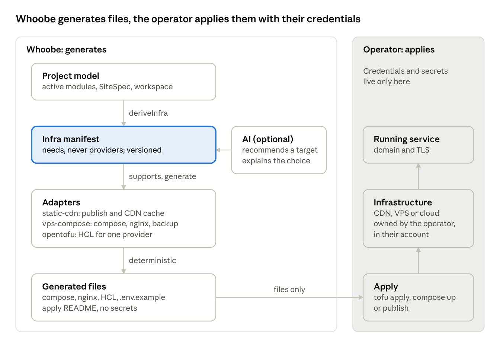

# Infrastructure from the project

*Date: 2026-10-28. Status: **design proposal, nothing built.** Depends on [projects-plan.md](projects-plan.md) for the `modules`
field. Statements about the code were checked in the repository on this date.*

## Context and goal

Whoobe proposes the best-fit infrastructure for a project from what the project already declares, and delivers it as standard files the
operator applies. It is "infrastructure from project": the source is not application code, it is the project model: active modules,
objects, assets, forms, pages when there is a website, automations, expected traffic.

Today the deployment choice is manual: the operator picks static publish, a VPS with compose or something else, and writes or adapts the
files by hand. The site wizard already collects the site's intent; what is missing is the step that turns it into infrastructure.

**Compared with Encore.** Encore derives infrastructure from code (resources declared as typed objects) and provisions it through Encore
Cloud. Whoobe starts from a higher-level declaration, the project, and stops at generation: no proprietary runtime, no managed cloud, no
lock-in on code conventions.

**Dependency.** The manifest's `modules` field assumes the project model described in [projects-plan.md](projects-plan.md): the instance
manifest is the union of the projects' modules. Until projects exist, modules are derived from websites.

**Positioning (later phase).** Positioning is deferred to a second phase, but it decides real feasibility: whether Whoobe offers value
that is added, unique and distinctive. The signal to test is the EU demand for open-source software free of binding commercial licences,
where the organisation keeps control of data location and of how GDPR and other EU rules are applied. Direct competitors either sell
their own hosting or have moved to source-available licences; infrastructure from the project, generated on accounts the operator owns,
fits that demand. Whoobe gives the organisation the means to make managing these rules easier: it chooses where data lives, keeps it
there, and stays in control of it.

## Principles and non-goals

Whoobe generates infrastructure, it does not operate it. Every other principle follows from this.

**Principles**

- **Generate, don't operate.** The output is files; `apply`, `up` and deployment are run by the operator.
- **No cloud credentials in the CMS.** Whoobe stores no provider keys, so it is not a target and does not answer for costs or downtime.
- **Standard, readable files.** Compose, nginx config, OpenTofu HCL: editable and usable without Whoobe.
- **Neutrality.** As with the automation engine, provider and topology are the operator's choice and responsibility; Whoobe recommends
  and explains.
- **Deterministic.** The same manifest always produces the same files; AI only takes part in the recommendation.
- **Few adapters, done well.** Extra adapters (more providers) only if sponsored, in line with the funded-work rule.

**Non-goals**

- A cloud control panel, monitoring or billing.
- Automatic provisioning with the operator's credentials.
- Real-time cost optimisation or managed autoscaling.
- Support for every provider: coverage grows only through funded or contributed adapters.

## Usage profiles and modules

The website is only one way to use Whoobe: the manifest lists the active modules, and the generated infrastructure contains only the
services those modules need. A profile is a named combination of modules, with an install path and a documentation page.

| Profile | Modules | Generated services | State in code |
| --- | --- | --- | --- |
| Website | `website`, `dam`, `data`, `forms`, `gateway` | core-api, gateway, asset-processor, publisher, DB, CDN or nginx | complete |
| DAM + API | `dam`, `data`, `gateway` | core-api, gateway, asset-processor, DB, storage | already served by `/client/v1` (per-class and asset scopes, rate limits, quotas, JWT, IP allow-list) |
| Data intake | `forms`, `data`, `gateway`, `automation` | core-api, gateway, DB, mail; webhooks to the external engine | partial: forms depend on websites |
| Data + events | `data`, `gateway`, `automation` | core-api, gateway, DB | `object-event-subscriptions` with a delivery log |

**The forms problem.** Today a form is born as a page node, upload fields are read from page content
(`apps/core-api/src/form-uploads.ts`), and Gateway keys and bindings are per website (`apps/gateway/src/site-auth.ts`). The Data intake
profile needs a Form as a standalone entity, authenticated with an API client, where the page is just one way to display it. That is a
model change, covered in [projects-plan.md](projects-plan.md).

**Product consequences**

- An instance without `website` hides the editor, themes and snippets in the menu and permissions.
- In a headless profile the Gateway is the front door: `security:api` must cover every profile, not only the website one.
- A few named profiles, not "does everything": each one explains itself in a line.

## Architecture



The boundary between the two boxes is the point of the design: only files leave Whoobe, and everything that touches a cloud account
happens on the operator's side.

## The infra manifest

The manifest describes the project's **needs**, never providers: it is the single source every adapter generates files from. It lives
with the project, is versioned, and is validated with zod like the `SiteSpec` (`packages/sdk/schema/src/site-spec.ts`).

**Proposed fields (v1)**

| Field | Values | Derived from |
| --- | --- | --- |
| `modules` | list of `website`, `dam`, `data`, `forms`, `gateway`, `automation` | profile chosen in the wizard, or modules active in the workspace |
| `delivery` | `none` \| `static` \| `dynamic` | only with `website`: `static` when no page needs a runtime |
| `data.db` | `small` \| `medium` | DataObject classes and volume |
| `api` | expected clients, requests per second | with `gateway`: configured API clients and rate limits |
| `forms` | count, target | `form` nodes in the SiteSpec or, later, Form entities |
| `media` | `none` \| `bucket`, estimated size | DAM library |
| `locales` | list | `website.supportedLocales` or content languages |
| `automation` | `none` \| `webhook` | event subscriptions and automations; the engine stays external |
| `traffic` | `low` \| `medium` \| `high` | **new question** in the wizard |
| `region` | e.g. `eu` | **new question** in the wizard |
| `budget` | monthly maximum, EUR | **new question**, optional |
| `backup` | frequency, retention | safe default, editable |
| `secrets` | names, never values | emitted by adapters as placeholders |
| `domain` | domain, TLS | instance or website settings |

**Example: brochure site with a contact form**

```json
{
  "version": 1,
  "modules": ["website", "dam", "data", "forms"],
  "delivery": "static",
  "data": { "db": "small" },
  "forms": { "count": 1, "target": "core-api" },
  "media": { "kind": "bucket", "sizeGb": 2 },
  "locales": ["it", "en"],
  "automation": "none",
  "traffic": "low",
  "region": "eu",
  "backup": { "every": "daily", "keepDays": 14 },
  "secrets": ["FORM_SMTP_PASSWORD"],
  "domain": { "name": "example.com", "tls": "letsencrypt" }
}
```

**Example: DAM + API profile, no website**

```json
{
  "version": 1,
  "modules": ["dam", "data", "gateway"],
  "delivery": "none",
  "data": { "db": "medium" },
  "api": { "clients": 3, "rps": 50 },
  "media": { "kind": "bucket", "sizeGb": 200 },
  "traffic": "medium",
  "region": "eu",
  "backup": { "every": "daily", "keepDays": 30 },
  "secrets": ["DB_PASSWORD", "STORAGE_ACCESS_KEY"],
  "domain": { "name": "api.example.com", "tls": "letsencrypt" }
}
```

Derivation is a pure function `deriveInfra(siteSpec, workspace, answers) → manifest`, testable without network. A form on a static site
still needs an endpoint: the typical case where the manifest makes explicit a requirement that today is discovered at deploy time.

## Adapters

Each adapter takes the manifest and returns a set of files plus an apply README; it makes no network calls. The first two build on what
Whoobe already does.

| Adapter | Recommended when | Output | Existing base |
| --- | --- | --- | --- |
| `static-cdn` | `website` with `delivery: static`, no other modules needing a public runtime | publish config, cache rules, DNS to set | `publish:site`, `publish:sync-cdn` |
| `vps-compose` | any profile on a single host, headless included (DAM + API) | `docker-compose.*.yml` with only the active modules' services, nginx, certbot, `.env.example`, backup scripts | `docker-compose.{apps,data,proxy}.yml`, `deploy/profiles` |
| `opentofu` | high traffic, a specific region, managed services (DB, object storage) | HCL modules for one provider, variables, outputs | new; one provider in the first version |

A profile can combine two adapters: a static site on `static-cdn` with forms and the Gateway on `vps-compose`. There is still one
manifest; each adapter takes its own part.

**Common contract**

```ts
interface InfraAdapter {
  id: string
  supports(m: InfraManifest): { ok: boolean; reasons: string[] }
  generate(m: InfraManifest): GeneratedFile[]   // path + content, deterministic
  estimate?(m: InfraManifest): CostEstimate     // optional, indicative
}
```

- `supports` explains why an adapter does not fit ("needs a DB, this target has none"): this becomes the recommendation text.
- `generate` reads no environment and holds no secrets: secrets come out as placeholders in `.env.example`.
- Adapters are tested with snapshots: same manifest, same files.
- A third-party adapter is a package implementing this interface, so provider coverage can grow outside core.

## Role of AI and the wizard flow

AI recommends and explains; file generation stays deterministic code. If no AI provider is configured, the flow still works with the
`deriveInfra` and `supports` rules.

1. **Extra wizard questions**: expected traffic, region, monthly budget (optional). Three questions, with defaults.
2. **Derivation**: `deriveInfra` produces the manifest from the SiteSpec, the workspace and the answers.
3. **Recommendation**: every adapter is asked through `supports`; valid ones are ranked by estimated cost and simplicity. AI, when
   present, writes the rationale in plain language from the `reasons`, without inventing numbers.
4. **Operator's choice**: they see the recommended target, the alternatives and an indicative cost, and can switch target or edit the
   manifest by hand.
5. **Generation**: download an archive, or write into an `infra/` folder of the project.
6. **Apply**: the operator follows the generated README (`tofu apply`, `docker compose up`, publish).

**Rules for AI**

- It produces no infrastructure files, only recommendation text and, at most, a proposed manifest that goes through zod validation.
- Cost estimates come from the adapters (versioned tables), never from the model, and are marked indicative with the pricing date.

## Day-2: evolution, backups, secrets

Creating infrastructure is the easy part; the real value is telling the operator what changes as the project grows.

- **Versioned manifest.** Every generation stores the manifest it used. On the next project change, `deriveInfra` produces a new
  manifest and Whoobe shows the diff in terms of resources: "this change adds: database `small`, media bucket".
- **Target change.** If the new manifest is no longer supported by the current target (a static site adding a members area), Whoobe flags
  it with the `reasons` and proposes the next target, with the data migration steps.
- **Hand-edited files.** Generated files carry a header with the manifest hash. If the operator edited them, Whoobe does not overwrite
  them: it writes the new version alongside and shows the diff.
- **Backups from day one.** Every target with data includes backup and restore (scripts for `vps-compose`, provider policies for
  `opentofu`), with a restore test command in the README.
- **Secrets.** The manifest holds names only. Adapters emit `.env.example` or HCL variables without values; values live only on the
  operator's side.

## Risks and open questions

**Risks**

| Risk | Mitigation |
| --- | --- |
| "Best fit" sets expectations of a guarantee | Say "recommended", with a rationale, an indicative cost and an override always available |
| Adapters age (provider APIs and prices) | Few adapters in core, dated price tables, others only if funded |
| A wrong day-2 diff leads to data loss | Never generate destructive actions automatically; data migration is always a documented manual step |
| AI invents costs or requirements | Numbers only from adapters; AI-proposed manifests go through zod validation |
| Scope drifts toward a managed cloud | Explicit non-goals; no provider credentials in the CMS |

**Open questions**

- [ ] Does the manifest live in the workspace database, in an exported `infra/` folder, or both?
- [ ] Which provider for the first `opentofu` adapter (Hetzner, AWS, Cloudflare)?
- [ ] Do a static site's forms always go to the instance's `core-api`, or also to an external endpoint?
- [ ] Do cost estimates go into the MVP or later?
- [ ] Is a CLI command (`whoobe infra generate`) needed besides the wizard UI?
- [ ] Does disabling a module only hide the UI, or also switch off its routes in core-api and the Gateway?
- [ ] Forms as standalone entities: covered in [projects-plan.md](projects-plan.md), needed before phase 6.

## Plan

The MVP covers the two targets Whoobe already knows how to serve; cloud through OpenTofu comes only once the manifest has proven stable.

1. **Phase 1: manifest.** Zod schema `InfraManifest` with `modules` in `packages/sdk/schema`, `deriveInfra` as a pure function, tests on
   typical cases (brochure, catalogue, DAM + API). No UI.
   - Exit: correct manifests for the sites in `examples/`, for the sandbox and for a site-less instance.
2. **Phase 2: `static-cdn` and `vps-compose` adapters.** `InfraAdapter` contract, compose with only the active modules' services,
   snapshot tests, apply README.
   - Exit: the sandbox deployment and a DAM + API instance are reproducible from the generated files.
3. **Phase 3: wizard.** Profile choice, the three new questions, recommendation with `reasons`, file download. AI text optional.
4. **Phase 4: day-2.** Stored manifest, resource diff, hand-edited files never overwritten.
5. **Phase 5: `opentofu`.** One provider, picked from the open questions; other providers only as funded or contributed adapters.
6. **Phase 6: standalone forms.** After the projects plan delivers them, the Data intake profile becomes complete.

The first concrete step is phase 1: a spike that writes the schema and tries it on two or three real sites before touching the wizard.
