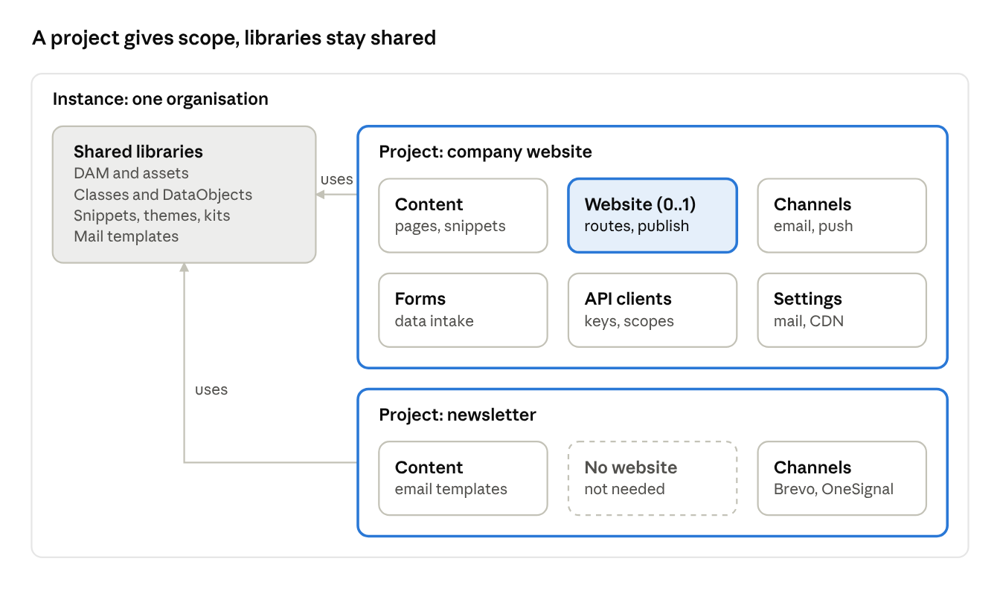

# Projects: a scope inside the workspace, with or without a website

*Date: 2026-10-28. Status: **design proposal, nothing built.** Related: [infrastructure-from-project.md](infrastructure-from-project.md),
[workspaces-plan.md](workspaces-plan.md). Statements about the code were checked in the repository on this date.*

## Context

Whoobe introduces the **project** as the top-level container inside an instance: a project may or may not have a website, and it has its
own content, channels, forms, API clients and settings. The website becomes one of the project's outputs.

Today the website already acts as a container, but only partly. From the schema in `packages/core/src/db`:

- **Already global** (no `website_id`): snippets, themes, kits, data classes and DataObjects, DAM assets.
- **Already site-less**: `whoobe_pages.website_id` can be null.
- **Tied to the website**: `website_templates` and `form_uploads` (`website_id` required), `search_documents`, overrides in
  `mail_settings` and `cdn_mirror` (null = installation default), Gateway API keys (`apps/gateway/src/site-auth.ts`).

Meanwhile Whoobe is already used without websites: the `/client/v1` API serves DataObjects and assets to external clients, and snippets,
pages and mail templates are already rendered as email for Brevo (`BrevoCampaignModal.vue`). What is missing is a container that scopes
this work without pretending it is a website.

## Principles and non-goals

A project is a scope, not a silo: it bounds settings, access and outputs, while libraries stay shared across the instance.

**Principles**

- **Shared libraries.** DAM, data classes, snippets, themes and kits stay at instance level; a project uses them, it does not copy them.
- **Settings cascade.** Instance → project, with today's rule (null row = installation default).
- **Optional website.** A project has zero or one website; the website is an output like email, campaigns and push.
- **Invisible to upgraders.** An existing instance works as before after the migration, with no manual steps.
- **Compatible permissions.** With no project assignments, function-based roles apply everywhere as they do today.

**Non-goals**

- Multi-tenancy: projects are initiatives of the same organisation. Another organisation is still another instance.
- Database-level data isolation between projects.
- More than one website per project in the first version.
- Marketing logic (lists, segments, consent, scheduled sending): it stays in the ESP.

## The model

Every project uses the instance's shared libraries and has its own content, channels, forms, clients and settings; a website exists only
where it is needed.

**Naming (proposed decision).** Keep both terms, each defined in one sentence in the glossary and at the top of the docs:

- *Workspace*: one Whoobe installation for one organisation (an ops term).
- *Project*: a unit of work inside the workspace, with or without a website.

The UI never shows "workspace": it shows the organisation's name, so users see "Acme / Newsletter", never two container words side by
side. The PWA/native generator stops using "project" ("Download Project") and says "PWA" and "Native app source (experimental)".

## What changes scope

Almost everything that has a `website_id` today moves to the project; what stays on the website is only about publishing.

| Entity | Today | After | Notes |
| --- | --- | --- | --- |
| Pages (`whoobe_pages`) | website, or null | project; website optional | a page with no website is content for channels |
| Snippets, themes, kits | instance | instance, plus project-owned (optional) | `project_id` null = shared library |
| DataObjects and classes | instance | instance | API scopes stay per class |
| DAM assets | instance | instance | possibly a default folder per project |
| `mail_settings` | instance → website | instance → project | same cascade |
| `cdn_mirror` | instance → website | instance → project | |
| Gateway API keys | website | project | `site-auth.ts` becomes `project-auth` |
| API clients (`/client/v1`) | instance | project (optional) | null = instance-wide as today |
| `form_uploads` | website (required) | form, hence project | see Forms as standalone entities |
| Event subscriptions | instance | project (optional) | |
| `website_templates` | website | website | publishing |
| `search_documents` | website | website | index of the published site |
| Mail templates | instance | instance or project | |

## Editor separate from the website

The editor produces channel-independent content; the website is just one renderer. Today `editor` and `website` are the same module:
they need to be split.

- **`editor` module**: a project's pages, snippets and templates, with or without a website. Active in every project that produces
  content, even without `website`.
- **`website` module**: routes, layout, applied themes, publish, search. It consumes the editor's content.
- **Per-channel renderers**: the same node tree becomes a web page, inline email HTML with a text alternative, or a push payload. The
  groundwork exists: `renderStaticHtml()`, `packages/core/src/mail/tailwind-inline.ts`, `packages/core/src/mail/html-to-text.ts`,
  `POST /whoobe-one/snippets/:id/render`.
- **Compatibility warnings**: the editor knows the target channel and flags what that channel does not support (for example flex layouts
  or scripts in an email).
- **UI**: a project without `website` shows no routes, layouts or publish; it shows content and the actions of its active channels.

## Channels and integrations

Whoobe produces the content and triggers the action; marketing logic stays in the ESP. Each channel is a renderer plus a delivery through
the Gateway, which already holds credentials, the outbound allow-list and the log.

| Channel | Render | Delivery | Today |
| --- | --- | --- | --- |
| Web | HTML page | publish or CDN | complete |
| Transactional email | inline HTML + text | SMTP, Resend, Brevo | form notifications and mail templates |
| Campaign | HTML with the ESP's merge tags | Brevo, HubSpot: creates the campaign, does not send it | Brevo from a snippet, page or template |
| Push | title, body, URL | OneSignal | push provider in `packages/core/src/push` |
| PWA | installable web app, service worker, offline | the organisation's own domain; push through OneSignal | template in `packages/sdk/pwa-template` |

**Triggers**

- Manual, from the editor (like today's "Create Brevo campaign").
- A DataObject event, through event subscriptions.
- A form submission.

**Boundaries**

- Lists, segments, consent, unsubscribe, scheduling and A/B tests belong to the ESP.
- Few adapters in core (Brevo, Resend, SMTP, OneSignal, already there); others as Gateway presets or plugins, funded or contributed.
- Provider credentials live in `integration-secrets` (encrypted), scoped to the project.

**PWA first, native experimental.** The PWA is a supported output of a project: same content and editor, distributed from the
organisation's domain with no store, no third-party review and no fees, which matches the sovereignty argument. The native pipeline in
`packages/mobile-app` (Expo and Capacitor projects) carries the real maintenance cost (SDK versions, Xcode, signing, store reviews) and
is marked experimental / community: it stays in the code, with no maintenance guarantee unless funded.

## Forms as standalone entities

A form becomes an entity of the project; the page node is just one way to show it. It is the inbound channel, symmetric to outbound
campaigns.

**Today**: a form is born as a page node, submissions go to `POST /public/forms/:classId/submit` or to the Gateway through a binding with
a `websiteId`, upload fields are read from page content (`apps/core-api/src/form-uploads.ts`), and the key is per website.

**After**

- **Definition**: fields, validation, target DataObject class, notifications (mail templates), automations. It lives in the project,
  with a stable id.
- **Views**: a `form` node in a page that points to the entity; an embeddable snippet for external sites; none, for apps that submit
  straight through the API.
- **Authentication**: a project key or an API client with a `forms:submit:<form>` scope; rate limits and quotas like other clients.
- **Uploads**: upload fields are read from the definition, no longer from page content; `form_uploads` references the form.
- **Compatibility**: existing forms in pages are extracted into entities during the migration, and the page node becomes a reference.

## Permissions

Roles stay function-based; the project only adds an optional restriction on where they apply.

- **No assignments**: a user with a role exercises it on every project, as on every website today.
- **With assignments**: `user → projects` restricts content, channel and form permissions to those projects. Shared libraries stay
  readable by everyone, writable according to role.
- **Project settings**: editable by whoever has `settings:manage` on the instance, or a new `project:manage` permission on the project.
- **Audit**: every event also records the project, so the log can be filtered by project.
- **Server-side enforcement**: the project filter applies in core-api and Gateway queries, not only in the dashboard menu.

## Migration

Every existing website becomes a project with that website; upgraders do nothing.

1. Create the `projects` table and add a nullable `project_id` to the tables that change scope.
2. For each row in `websites`: create a project with the same name and link the website to it.
3. Copy `website_id` → `project_id` on pages, `mail_settings`, `cdn_mirror`, Gateway keys.
4. Pages with a null `website_id` go to a "General" project, created only if there are any.
5. Extract forms from page nodes into Form entities and replace the nodes with references.
6. Keep the old columns and the `X-Whoobe-Site-Id`/`X-Whoobe-Site-Key` headers for one release, accepted as aliases of the project key,
   so already published sites keep working.
7. Remove the aliases in the following release, with a note in the release notes.

The migration is tested on the sandbox data and on a real instance before release, checking that public routes answer as before.

## Relation to the infrastructure design

Deployment stays per instance: one infrastructure, whose manifest is the union of the modules declared by the projects.

- Each project declares its modules (`editor`, `website`, `forms`, `channels`, `gateway`, `automation`); the instance manifest unites them
  and adds the shared libraries (`dam`, `data`).
- The day-2 diff reads per project: "project *Newsletter* adds the email channel, no new service".
- A project with a static website can use `static-cdn` while the rest of the instance runs on `vps-compose`.
- The "Content + channels" profile needs no publisher or CDN: the external ESP does the sending, so cloud is the operator's choice.

[infrastructure-from-project.md](infrastructure-from-project.md) depends on this for its `modules` field: in its phase 1, modules can be
derived from websites, then from projects once they exist.

## Risks and open questions

**Risks**

| Risk | Mitigation |
| --- | --- |
| The deepest change since 0.1: schema, permissions, Gateway, publish, dashboard | Separate phases, each releasable; compatibility aliases for one release |
| Published sites stop submitting forms or calling the Gateway | `X-Whoobe-Site-*` headers accepted as aliases; public route tests before and after |
| Projects get read as multi-tenancy | Explicit non-goal in the docs; another organisation = another instance |
| Project filters only in the UI | Filter in server-side queries; cases in `security:api` |
| The channels module drifts into a marketing tool | ESP boundaries written into the design and the docs |

**Open questions**

- [ ] Are project-owned snippets and themes needed right away, or is the shared library enough?
- [ ] Can a project have more than one website later (microsites, landing pages)? That changes the 0..1 constraint.
- [ ] Does the DAM need per-project folders or permissions, or does it stay fully shared?
- [ ] Do existing API clients stay instance-wide, or get assigned to a project during migration?
- [ ] Naming: confirm the proposed decision (workspace = installation, project = unit of work, organisation name in the UI).

## Phased plan

Each phase is releasable on its own and leaves the instance working as before.

1. **Phase 1: project as container.** `projects` table, `project_id` on tables, website → project migration, project selector in the
   dashboard. No behaviour change.
   - Exit: an upgraded instance shows one project per website, everything else unchanged.
2. **Phase 2: per-project settings and keys.** Instance → project cascade for mail and CDN, per-project Gateway keys with
   `X-Whoobe-Site-*` aliases.
3. **Phase 3: editor without a website.** Split the `editor` and `website` modules; site-less projects in the UI; per-channel
   compatibility warnings.
4. **Phase 4: channels.** The existing email, campaign and push rendering becomes a common model, with manual, event and form triggers.
5. **Phase 5: standalone forms.** Form entity, extraction from page nodes, `forms:submit` scope, uploads from the definition.
6. **Phase 6: per-project permissions.** Optional assignments, server-side filter, per-project audit.
7. **Remove the aliases** in the release after phase 2.

The first concrete step is a phase 1 spike on a branch: schema, migration and tests on a copy of the sandbox data.
