# Website Publish Plan: Dev → Production (Phase 2)

## Goal

Create a procedure to publish a website's frontend from a **development environment** (where authors edit pages) to a **production environment** (where visitors see them). The output is a standalone Next.js app per website — fully rendered server-side, with SEO metadata, build-time Tailwind CSS, resolved data bindings, and static or ISR-served HTML.

## Current Architecture vs Target

### Today
```
whoobe-one-spike (SPA, port 3006)
├── Editor routes (Main, Editor, Preview)
├── PublicPage.vue (catch-all — renders published pages)
├── Runtime Tailwind ( @tailwindcss/browser )
├── Runtime theme injection (useThemeStyles composable)
├── Runtime data binding resolution (calls core-api)
└── nginx: /whoobe-one/ → :3006
```

### Target
```
                ┌──────────────────────────────┐
                │  production (Vercel / Node)   │
                │                               │
dev env         │  next-site-my-site            │
┌──────────┐    │  ┌────────────────────────┐   │
│ core-api │◄───│──│ getPageData() / ISR    │   │
│ (public) │    │  │ walkTree() → descriptor│   │
│          │    │  │ <WhoobePage /> → React  │   │
│ themes   │    │  │ Tailwind v4 build-time  │   │
│ assets   │    │  │ Theme CSS @theme vars   │   │
│ fonts    │    │  │ Google Fonts <link>     │   │
└──────────┘    │  └────────────────────────┘   │
                └──────────────────────────────┘
```

## Pipeline

```mermaid
flowchart LR
    A[Developer runs pnpm publish:next-site] --> B[CLI generates Next.js app]
    B --> C[Fetch all published pages for the website]
    C --> D[Extract Tailwind classes from element trees]
    D --> E[Fetch website theme + fonts + custom CSS]
    E --> F[Write theme CSS variables + fonts to scaffold]
    F --> G[Write app/ pages with generateStaticParams]
    G --> H[pnpm install && pnpm build]
    H --> I[Deploy to Vercel / Docker]

    style A fill:#6366f1,color:#fff
    style I fill:#22c55e,color:#fff
```



### What we already have (reusable)

**`@whoobe-cms/next`** (`packages/sdk/next/src/index.ts`):

| Function | What it does | Reuse |
|---|---|---|
| `getPageData()` | Fetches a published page via public API, walks the tree server-side (`walkTree`), composes website-template layout. Returns `{ page, params, descriptor, layout }` | Works as-is. Accepts `revalidate` for ISR |
| `generateMetadataFromPage()` | Builds Next.js `Metadata` from the page's `seo` object (metaTitle, metaDescription, ogImage, robots) | Works as-is |
| `staticParamsForSlugs()` | For `generateStaticParams` — maps an array of slugs to `{ locale, slug }` | Works as-is |
| `staticParamsForRecords()` | For `generateStaticParams` on dynamic pages — extracts `{ locale, slug }` from data object records | Works as-is |

**`@whoobe-cms/renderer`** (`packages/sdk/renderer/src/`):

| Module | What it does | Reuse |
|---|---|---|
| `walkTree()` | Recursive tree walker: validates against schema, resolves data bindings (object/query/field), resolves images, resolves links. Returns a serializable `RenderDescriptor` tree | Works as-is. Framework-agnostic, runs in Node.js |
| `composeLayout()` | Wraps the body descriptor with header/aside/footer from website templates. Returns `ComposedLayout` | Works as-is |
| `ApiClient` | Typed public API client (`getPage`, `getObject`, `queryObjects`, `search`, `submitForm`) | Works as-is |
| `RenderDescriptor` | Framework-agnostic rendering instructions: `{ kind, tag, className, style, content, children, formConfig, ... }` | Works as-is |

**`@whoobe-cms/react`** (`packages/sdk/react/src/`):

| Component | What it does | Reuse |
|---|---|---|
| `WhoobeProvider` | Provides registry + api + options via React context | Works as-is |
| `WhoobeNode` | Maps `RenderDescriptor.kind` → registered component → renders recursively | Works as-is |
| `WhoobePage` | Fetches page + walks + renders with layout shell. Accepts a pre-walked `descriptor` for SSR (walk server-side, hydrate client-side) | Works as-is |

---

## What we need to build

### 1. CLI Generator (`@whoobe-cms/publish`)

A new package with a CLI that scaffolds a standalone Next.js app for a given website.

```bash
pnpm publish:next-site \
  --api-url https://cms.example.com \
  --website-id <uuid> \
  --out-dir ./sites/my-site \
  --revalidate 60 \
  --domain example.com
```

**Input parameters:**

| Flag | Description |
|---|---|
| `--api-url` | Base URL of the CMS public API (production instance) |
| `--website-id` | UUID of the website to publish |
| `--out-dir` | Output directory for the generated Next.js project |
| `--revalidate` | ISR revalidate time in seconds (default: 60) |
| `--domain` | Custom domain for the site (optional, for metadata) |

**What it generates:**

```
sites/my-site/
├── package.json              # next, react, @whoobe-cms/react, tailwindcss, etc.
├── next.config.js            # ISR revalidate, assetBaseUrl, images domains
├── postcss.config.mjs        # Tailwind PostCSS plugin
├── tailwind.config.ts        # With safelist[] from class extraction
├── app/
│   ├── layout.tsx            # HTML shell: <WhoobeProvider> + theme CSS + Google Fonts
│   ├── page.tsx              # Home page (slug: /), reuses getPageData()
│   ├── [locale]/
│   │   ├── page.tsx          # Locale-root pages
│   │   └── [...slug]/
│   │       └── page.tsx      # Catch-all: /{locale}/{slug} → getPageData()
│   └── sitemap.ts            # Dynamic sitemap from pages.list()
├── src/
│   ├── lib/
│   │   ├── api.ts            # ApiClient singleton (from baseUrl)
│   │   └── registry.ts       # Component registry with defaults
│   └── components/
│       └── whoobe.tsx        # Optional component overrides
├── public/
│   └── favicon.ico
├── next-env.d.ts
└── tsconfig.json
```

**Package structure:**

```
packages/publish/
├── package.json              # @whoobe-cms/publish
├── tsconfig.json
├── src/
│   ├── index.ts              # Public API (only the generate function)
│   ├── cli.ts                # CLI entry point (bin)
│   ├── scaffold.ts           # Generates the Next.js project structure
│   ├── class-extractor.ts    # Recursively collects all CSS classes from element trees
│   ├── theme-css.ts          # Generates @theme CSS variables from website theme
│   ├── api.ts                # Fetches pages, themes, etc. from the public API
│   └── templates/
│       ├── layout.tsx.hbs
│       ├── page.tsx.hbs
│       ├── [...slug]/page.tsx.hbs
│       ├── package.json.hbs
│       └── ...
└── bin/
    └── publish-next-site.js  # CLI entry: tsx src/cli.ts
```

### 2. Tailwind CSS Handling

The generated Next.js app uses **build-time Tailwind** (PostCSS plugin), **not** runtime `@tailwindcss/browser`.

**Safelist extraction:**

```typescript
// packages/publish/src/class-extractor.ts

function collectClassesFromTree(node: WhoobeElementNode, set: Set<string>): void {
  // Classes from the CSS controls
  if (node.css?.css) {
    for (const cls of node.css.css.split(/\s+/)) {
      if (cls) set.add(cls)
    }
  }
  if (node.css?.container) {
    for (const cls of node.css.container.split(/\s+/)) {
      if (cls) set.add(cls)
    }
  }
  // Arbitrary values like p-[12px]
  if (node.css?.css) {
    const arbitrary = node.css.css.match(/\[[^\]]+\]/g)
    if (arbitrary) arbitrary.forEach((a) => set.add(a))
  }
  // Recurse
  for (const child of (node.blocks ?? [])) {
    collectClassesFromTree(child, set)
  }
}
```

The generator:
1. Fetches all published pages via the API
2. Calls `collectClassesFromTree()` on every page's `content` field
3. Merges the theme's `tailwindClasses` field
4. Writes the result as `tailwind.config.ts` with a `safelist` array

**Theme → CSS variables:**

```typescript
// packages/publish/src/theme-css.ts

function generateThemeCss(theme: WebsiteTheme): string {
  const colorVars = theme.colors
    .map((c) => `  --color-${c.name}: ${c.hex};`)
    .join('\n')
  return `@theme {\n${colorVars}\n}\n\n${theme.styles ?? ''}`
}
```

Generated `layout.tsx` imports this CSS and Google Fonts:

```tsx
// Generated in layout.tsx
import './globals.css'     // Contains @theme variables + theme.styles
// Google Fonts <link> tags from theme.fonts
export const metadata = {
  // From website settings
}
```

### 3. Asset Handling

Assets are stored in MinIO/S3 and served through the CMS's `/dam-asset/` proxy.

**Two options for production asset serving:**

#### Option A: S3/DAM public endpoint (recommended)

Generate the Next.js app with `assetBaseUrl` pointing at the CMS's DAM proxy:

```ts
// next.config.js
const nextConfig = {
  assetBaseUrl: 'https://cms.example.com/dam-asset'
}
```

This requires the CMS to be running in production and accessible. All DAM references in element trees resolve to:

```
https://cms.example.com/dam-asset/{s3-object-key}
```

**Pros:** No asset duplication, no sync needed, always up to date
**Cons:** CMS must stay running, adds a dependency for the published site

#### Option B: Download assets to a public folder during generation

The generator script downloads all referenced images from MinIO/S3 into the Next.js app's `public/` folder, then rewrites the element tree references to point at the local files.

```typescript
// During generation:
for each image reference in element trees:
  download from S3_PROXY_URL/{s3-key}
  save to out-dir/public/assets/{s3-key}
  rewrite reference to /assets/{s3-key}
```

The generated `next.config.js` sets `images.unoptimized = true` (for static export) or uses the local `/assets/` path.

**Pros:** Fully self-contained site, no dependency on CMS after generation
**Cons:** Asset duplication, re-generate needed when assets change, larger output

**Recommendation:** Start with Option A (proxy). The `/dam-asset/` path is already nginx-cached with `expires 1y` — production-grade. Option B is available for fully static deployments (Phase 3).

#### UUID asset resolution

Currently `resolveImageUrl()` in `packages/sdk/renderer/src/url.ts` returns `null` for UUID references (documented gap). For the published site, we need to handle UUID → URL resolution.

The cleanest approach is a **public endpoint** on core-api that resolves an asset UUID to its DAM URL:

```
GET /public/assets/:uuid → { url: "https://cms.example.com/dam-asset/{s3-key}" }
```

This endpoint returns a 301 redirect or JSON with the resolved URL. The `resolveImageUrl()` function in the SDK can then call this endpoint for UUID references when an `assetResolver` option is provided.

**Implementation:**
- Add `GET /public/assets/:uuid` to core-api (no auth, respects published/public assets only)
- Add an optional `resolveAssetUuid(uuid): Promise<string>` callback to `RenderOptions` in `@whoobe-cms/renderer`
- In the `@whoobe-cms/next` helpers, wire this callback to the new endpoint

For Option B (downloaded assets), the generator resolves all UUIDs during generation and writes the URL directly into the descriptor, so no runtime UUID resolution is needed.

### 4. CLI Implementation

```typescript
// packages/publish/src/cli.ts

import { Command } from 'commander'  // or just parse process.argv manually
import { generateNextSite } from './scaffold.js'
import { fetchAllPages, fetchWebsite, fetchTheme } from './api.js'
import { collectClasses } from './class-extractor.js'
import { generateThemeCss } from './theme-css.js'
import { writeScaffold } from './scaffold.js'

async function main() {
  const { apiUrl, websiteId, outDir, revalidate, domain } = parseArgs()

  // 1. Fetch website info + themes
  const website = await fetchWebsite(apiUrl, websiteId)
  const themes = await fetchWebsiteThemes(apiUrl, websiteId)

  // 2. Fetch all published pages for the website
  const pages = await fetchAllPages(apiUrl, websiteId)

  // 3. Extract all Tailwind classes from element trees
  const classSet = new Set<string>()
  for (const page of pages) {
    collectClassesFromTree(page.content, classSet)
  }
  for (const t of themes) {
    for (const cls of (t.tailwindClasses ?? '').split(/\s+/)) {
      if (cls) classSet.add(cls)
    }
  }

  // 4. Generate theme CSS
  const themeCss = themes.map(generateThemeCss).join('\n')

  // 5. Write the scaffolded Next.js app
  await writeScaffold({
    outDir,
    apiUrl,
    websiteId,
    website,
    pages,
    safelist: [...classSet],
    themeCss,
    themeFonts: extractFonts(themes),
    revalidate,
    locale: website.defaultLocale,
    locales: website.supportedLocales,
    domain,
  })
}
```

---

## Edge Cases

| Case | Handling |
|---|---|
| **Dynamic pages** (`{slug}` pattern) | `staticParamsForRecords()` queries data objects at build time via `ApiClient.queryObjects()`; ISR with `revalidate` for new records |
| **Multi-language** | URL pattern `/{locale}/[...slug]`. All locales fetched at build. Layout reads `params.locale` to set `lang` attribute |
| **Website template** | `composeLayout()` wraps the body descriptor with header/aside/footer. All module pages rendered server-side |
| **Forms** | Form submissions POST directly to `POST /public/forms/:classId/submit` via the client-side `useForm` composable — no server rendering needed |
| **Search** | The search page renders a client component that calls `GET /public/search` directly — no server rendering needed |
| **Unpublished / draft pages** | Not included. The generator only fetches `published: true` pages |
| **Large number of pages** | `generateStaticParams` handles thousands of pages; ISR with `revalidate` for dynamic pages |
| **Page reordering / new pages** | Next.js ISR picks up new pages on revalidation; full re-generation for slug changes |
| **Theme changes** | ISR refreshes the page; theme CSS changes require re-generation of the scaffold (theme is embedded at build time) |

---

## Gaps to Close

### 1. UUID asset resolution

Add a public endpoint to resolve asset UUIDs:

```
GET /public/assets/:uuid → 301 redirect to /dam-asset/{s3-key}
```

This requires:
- An endpoint in core-api that looks up an asset by UUID in the `dam_assets` table and returns its S3 key
- The endpoint must only serve assets that are "published" (no concept of unpublished assets exists yet — all assets are public by default since the DAM has no publish gate)

### 2. Clarity: The generator is a build-time tool

The generated Next.js app is **not** a runtime — it's a deployable project that calls the CMS's **public API** at request time (with ISR caching). There is no syncing, no replication of the CMS database. The CMS stays the single source of truth.

The generation flow:
1. **At generation time:** CLI fetches tree metadata (class extraction for Tailwind safelist, theme CSS variable generation, page list for `generateStaticParams`)
2. **At build time:** `next build` calls `generateStaticParams` → fetches each page via `getPageData()` → walks tree → generates static HTML
3. **At request time:** ISR serves cached HTML; revalidates after `revalidate` seconds. New/updated pages are fetched live from the CMS API

This means:
- The CMS must be running and accessible from the Next.js server
- The Next.js app calls the CMS public API endpoints — no auth needed
- No database replication, no file sync (unless using Option B for assets)
- A CMS outage means the published site serves stale ISR cache (graceful degradation)

### 3. Sitemap

The generated Next.js app generates its own sitemap dynamically:

```ts
// Generated app/sitemap.ts
import { ApiClient } from '@whoobe-cms/renderer'
import type { MetadataRoute } from 'next'

const api = new ApiClient(process.env.CMS_API_URL!)

export default async function sitemap(): Promise<MetadataRoute.Sitemap> {
  const pages = await api.getAllPages() // hypothetical: fetch all published pages
  return pages.map((p) => ({
    url: `https://${domain}/${p.locale}/${p.slug}`,
    lastModified: p.updatedAt,
    changeFrequency: p.sitemap?.changefreq ?? 'weekly',
    priority: p.sitemap?.priority ?? 0.5,
  }))
}
```

No CMS endpoint needed for sitemap data — the Next.js app fetches pages through the same public API at build/ISR time.

---

## Deployment Options

### Option A: Vercel (recommended)

1. Each website's Next.js app is a separate Vercel project
2. Environment variable: `CMS_API_URL=https://cms.example.com`
3. Automatic ISR, CDN, SSL, custom domains
4. Build command: `next build`
5. ISR revalidate: 60s (configurable per site)

**Pros:** Zero ops, built-in CDN, automatic SSL, preview deploys
**Cons:** Vendor lock-in, cost per project

### Option B: Docker + Node

```dockerfile
FROM node:20-alpine
WORKDIR /app
COPY . .
RUN pnpm install && pnpm build
EXPOSE 3000
CMD ["pnpm", "start"]
```

Run behind nginx per domain:

```nginx
server {
    listen 443 ssl;
    server_name example.com;
    location / {
        proxy_pass http://127.0.0.1:4000;  # per-site port
    }
}
```

**Pros:** Self-hosted, no vendor dependency
**Cons:** Requires Node server per site, no built-in CDN

### Option C: Static export

```bash
next build && next export   # outputs out/
```
Deploy to S3 / Cloudflare Pages / Netlify.

**Pros:** Cheapest hosting, zero server
**Cons:** No dynamic data, no ISR, full rebuild on content changes

---

## Implementation Order

```
1. Add GET /public/assets/:uuid endpoint to core-api
   ├── Look up asset by UUID in dam_assets table
   ├── Return 301 redirect or JSON with resolved URL
   └── Wire resolveAssetUuid callback in SDK RenderOptions

2. Create @whoobe-cms/publish package
   ├── package.json, tsconfig.json
   ├── cli.ts — parse CLI args
   ├── api.ts — fetch website, pages, themes
   ├── class-extractor.ts — recursive tree walk for Tailwind classes
   ├── theme-css.ts — @theme CSS variable generation
   ├── scaffold.ts — write Next.js project files
   └── templates/ — EJS/JSX templates for generated files

3. Add bin entry and wire into monorepo
   ├── packages/publish/package.json "bin" field
   ├── Root package.json "publish:next-site" script
   └── Verify with `pnpm publish:next-site --help`

4. Test with a real website
   ├── Create a website with pages, templates, themes
   ├── Run generator
   ├── Build generated Next.js app
   ├── Deploy to Vercel
   └── Verify pages, SEO metadata, images, forms, search

5. Document the procedure
   ├── docs/release/operations/deployment.md — add "Publishing a website" section
   └── Include: prerequisites, CLI usage, Vercel setup, custom domain
```
