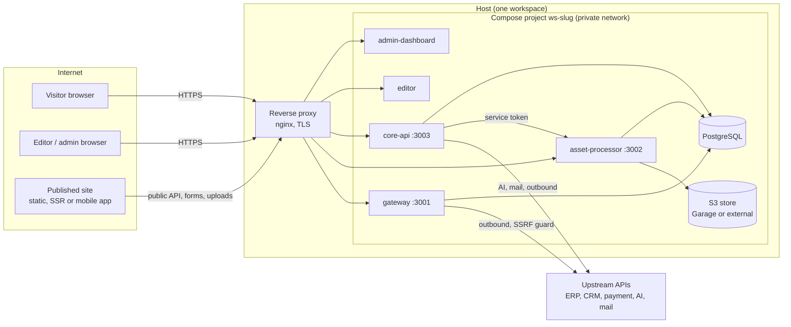

# Architecture overview

For IT architects, DevOps and security reviewers. This page says what runs, what talks to what, where the trust
boundaries are and which parts hold state. Every statement here was taken from the code or the compose files of this
repository; where something is **not** implemented it says so. Companion documents:
[data and storage](data-and-storage.md), [authentication and authorization](authentication-and-authorization.md),
[threat model](../security/threat-model.md), [configuration reference](../operations/configuration-reference.md),
[capacity and scaling](../operations/capacity-and-scaling.md), [automations](automations.md).

## 1. What the product is, technically

A TypeScript monorepo (pnpm workspaces, Turborepo) that builds six runtime services and a set of build-time tools.
Node.js 22 (Debian bookworm-slim) for the three backends, nginx (unprivileged, Alpine) for the two browser applications,
PostgreSQL 16, and an S3-compatible object store (Garage by default, any S3 in production).

| Part | Kind | Port (container) | Responsibility | State it owns |
|---|---|---|---|---|
| **core-api** | Express service | 3003 | Authentication and sessions, users/roles/permissions, websites, pages, snippets, data classes and objects, themes, menus, workflows, mail, AI calls, website export/import, public read API, public form submission, form-upload approval. **Runs the database migrations at start.** | PostgreSQL (all CMS data); in-memory limiters and caches |
| **asset-processor** | Express service | 3002 | DAM: upload, folders, image transforms and thumbnails, metadata, the `/dam-asset/*` delivery proxy that reads S3 with its own credentials, receipt of form-upload bytes, log file storage | S3 bucket; asset records in PostgreSQL |
| **gateway** | Express service | 3001 | API Gateway: stored upstream endpoints and routes, OpenAPI import, credential injection, rate limiting, result filters, form submit forwarding, plugins and vendor presets | PostgreSQL (endpoints, routes, bindings); encrypted upstream credentials |
| **admin-dashboard** | Vue 3 SPA behind nginx | 8080 (published as 3000) | The administration UI | none (static files) |
| **whoobe-one-spike** (the editor) | Vue 3 SPA behind nginx | 8080 (published as 3006) | The page, snippet and template editor; embedded by the dashboard in a frame; also serves published pages for preview | none (static files) |
| **postgres** | PostgreSQL 16 (alpine, pinned by digest) | 5432 | The system of record | volume `pgdata` |
| **garage** (profile `local-s3`) | S3-compatible store | 3900 (published as 9000) | Asset storage when no external S3 is configured | volume `garagedata` |

Build-time and operator tools (not long-running): `packages/migration-tool` (Pimcore import), `packages/publish`
(generates Next.js, Nuxt, static or documentation sites), `packages/mobile-app` (Capacitor generator), the scripts in
`scripts/` (workspace provisioning, backup, restore, certificates, release), and the security harness in
`scripts/security/`.

Shared libraries: `packages/core` (database access, auth, DAM storage, portability, uploads, mail, gateway helpers,
HTTP hardening), `packages/sdk/*` (schema and sanitizer, renderer, React/Vue/Svelte adapters), `packages/logger`.
The three backends import `@whoobe-cms/core` directly and share one database schema: there is no internal RPC layer
between them other than the two HTTP calls listed in section 4.

## 2. System context

Reading guide: browsers and published sites only ever speak to the reverse proxy. The proxy routes by path to the five
upstreams (section 3). The databases and the object store are not reachable from outside the host (section 5).

## 3. Routing at the edge

The nginx template `deploy/nginx/_locations.conf.template` is the single routing definition (rendered per workspace
into `deploy/nginx/_locations-<slug>.inc`; re-render with `scripts/render-workspace-nginx.sh`):

| Path | Upstream | Notes |
|---|---|---|
| `/` | admin-dashboard (or a website preview, decided by core-api `GET /site-root`) | previews live at the website's root path |
| `/whoobe-one/(websites|themes|pages|snippets|templates|kits|website-paths|search|settings)/…` | core-api | editor-side API |
| `/whoobe-one/…` (rest) | editor SPA | |
| `/auth`, `/documents`, `/snippets`, `/data-*`, `/mail-*`, `/public`, `/ai`, `/settings`, `/users`, `/roles`, `/preview`, `/health`, … | core-api | the regular expression is in the template |
| `/public/upload-data/` | asset-processor | bytes of form uploads, request buffering off (`^~` so the rule above does not take it) |
| `/api/v1/gateway/`, `/api/remote/` | gateway | |
| `/api/v1/` | asset-processor | DAM and image API |
| `/dam-asset/` | asset-processor | asset delivery, `expires 1y` for public files |
| `/assets/` | static assets of the SPAs | |

One body-size cap (`client_max_body_size`, `WS_MAX_BODY`, default 100 MB) applies to the whole server.

## 4. Component interactions

| From | To | How | Why |
|---|---|---|---|
| browsers | all five services | HTTPS via the proxy | UI, API |
| core-api, asset-processor, gateway | PostgreSQL | one pooled connection per process (`pg`, default pool), optional TLS (`DB_SSL`) | all state; **sessions are checked against the same database by core-api and asset-processor** |
| asset-processor, core-api | S3 | AWS SDK with the operator's credentials; the browser never receives them | assets, backups of logs |
| core-api → asset-processor | HTTP, `Authorization: Bearer DAM_SERVICE_TOKEN` | reads documents of documentation sites, system logs, **attaches form uploads** (`POST /api/v1/dam/form-uploads/attach`) | the only service-to-service calls |
| gateway → core-api | HTTP | resolves page bindings | |
| core-api, gateway → third parties | outbound HTTPS through `safeFetch` | AI providers, mail providers, OpenAPI import, upstream APIs | the SSRF guard refuses loopback, link-local/metadata and (optionally) private ranges |
| published site → core-api / gateway | HTTPS | public read API, form submit, gateway resolve with a per-website key | |
| visitor browser → asset-processor | `PUT /public/upload-data/<ticket>` | file bytes, authorised by a signed ticket from core-api | no S3 URL is ever exposed |

There is no message queue, no cache service and no search engine process: search is implemented in the application
(`search_documents` table, MiniSearch for documentation sites); background work is a handful of `setInterval` timers
inside the services (for example the clean-up of unused form uploads in asset-processor).

## 5. Trust boundaries and exposure

| Boundary | Crossing | Control |
|---|---|---|
| Internet → proxy | all traffic | TLS 1.2/1.3 only, HSTS (template `workspace-ssl.conf.template`, F-049); body cap; the proxy is the only listener when `WS_APP_BIND_ADDRESS=127.0.0.1` (set by the workspace scripts) |
| proxy → services | HTTP on loopback | `TRUST_PROXY=1` so that client addresses used by limiters come from `X-Forwarded-For` |
| services → PostgreSQL / S3 | private Compose network; ports published on `127.0.0.1` only (`WS_DATA_BIND_ADDRESS`) | credentials required by Compose (it refuses to start without them) |
| anonymous → public surface | `/public/*`, `/preview/*`, `/dam-asset/*`, `/health` | read-only data, rate limits per address, only published content, only public assets, CORS without credentials |
| authenticated → admin surface | everything else | session cookie, permission per route (214 core-api routes are in a contract file checked by tests, see [auth](authentication-and-authorization.md)) |
| operator URLs → outbound | gateway upstreams, OpenAPI import, AI endpoints, mail providers | `safeFetch` SSRF guard |
| uploaded content → storage / browsers | DAM uploads, form uploads, documents | extension and content checks, image re-encoding, `Content-Security-Policy: sandbox`, `attachment` for active types, private by default |
| author content → visitors | rich text, SVG, Markdown | server-side allow-list sanitizer in `packages/sdk/schema/src/sanitize.ts`, applied when content is served |

## 6. Deployment topologies

| Topology | How | Use |
|---|---|---|
| Development | `docker compose up -d --build` (or `dev-cms.sh`), all ports on all interfaces | developers; secrets are placeholders in `.env.example` and the compose file refuses to start without the real ones |
| **Workspace** (the production unit) | `scripts/provision-workspace.sh <slug> <host> <index>` writes `.env.<slug>` (fresh secrets), starts a Compose project `ws-<slug>` with its own PostgreSQL, its own S3 store (or an external bucket), all five services, and an nginx include; `enable-tls.sh` adds the certificate | one customer / one environment |
| Shared proxy | `docker-compose.proxy.yml` runs one nginx for several workspaces on a host that has no nginx | small hosts |
| Public sandbox | a workspace with `deploy/profiles/sandbox.env` (AI, mail, imports, CDN mirror and outbound HTTP off; asset caps; rebuilt every three hours) | demos |
| Published sites | generated by `packages/publish` as Next.js / Nuxt / static / documentation sites with their own standalone Dockerfile, or as a Capacitor app | the public face of a customer; they talk to the workspace through the public API only |

Not provided: Kubernetes manifests or a Helm chart, a managed-database variant of the compose file (use `DB_HOST` and
`DB_SSL` to point at one), an HA reference architecture. See [capacity and scaling](../operations/capacity-and-scaling.md).

## 7. Deployment model: one organisation per instance

**Whoobe is not a shared multi-tenant platform, by design.** The rule for deployment is:

| Situation | How to deploy |
|---|---|
| One organisation, one or several websites, several teams or **divisions of the same entity** | **one workspace**; the divisions are told apart with roles and permissions |
| Different companies, customers or legal entities | **one workspace each** (own database, bucket, secrets, containers, host name) - never the same instance |

A host may run many workspaces (`provision-workspace.sh`), which is how an agency or a hosting provider serves several clients,
but each workspace is an independent installation. Offering one instance to unrelated entities is not a supported model: the
isolation between them would rest on application roles only, and the product has no per-tenant scoping of data, no per-tenant
quotas and no per-tenant keys. If that is ever wanted, a different architecture is needed (row-level tenancy, tenant-scoped keys,
CSP and rate limits per tenant), not a configuration.

- **A workspace is the tenant and the security boundary.** Separate database, separate bucket or Garage volume,
  separate secrets, separate containers and ports; two workspaces share nothing but the host. The isolation test suite
  (`scripts/security/api` isolation tests on two stacks, 14 tests) checks that credentials and data of one do not work
  in the other.
- **A website inside a workspace is not a security boundary.** Roles and permissions are workspace-wide
  (`user_roles` has a user and a role, nothing else). Anyone who may edit pages may edit the pages of every website of
  that workspace. Roles describe **function** (editor, publisher, administrator), not **division**: if a division must not touch
  another division's websites, that fence does not exist inside a workspace (per-website permissions are not implemented).
- Per-website configuration (themes, templates, mail provider, upload limits, API keys of the gateway, domains) is data
  inside one workspace.

## 8. Technology and support matrix

| Item | Version / choice | Notes |
|---|---|---|
| Runtime | Node.js 22 (`node:22-bookworm-slim`, pinned by digest) | no npm/pnpm/corepack in the runtime images |
| Containers | run as an unprivileged user (UID 1000 for Node, 101 for nginx); `HEALTHCHECK` on the three backends | the main compose file sets no read-only root filesystem, no dropped capabilities and no resource limits; the overlay `docker-compose.sandbox.yml` does (read-only root with tmpfs for `/tmp` and logs, `cap_drop: ALL`, `no-new-privileges`, `pids_limit`, memory and CPU limits) and can be layered on any workspace with `COMPOSE_FILE` |
| Database | PostgreSQL 16 | other versions untested; migrations are plain SQL (53 files) |
| Object storage | Garage v2.4.1 (default), AWS S3 or any S3 API (`S3_FORCE_PATH_STYLE`) | MinIO was removed from the stack (F-048/F-050) |
| Browsers | current Chromium-based browsers are what the Playwright suite uses; no support matrix is defined | |
| CPU | amd64 and arm64 (the reference install ran on arm64) | |
| Reverse proxy | nginx (host or `docker-compose.proxy.yml`) | other proxies need the routing table of section 3 |
| TLS certificates | Let's Encrypt via `enable-tls.sh` / `renew-certs.sh`, or your own | |

## 9. What is deliberately not in the architecture

No SSO/SAML/OIDC (local accounts with optional TOTP), no per-website RBAC, no audit-log service (see
[observability](../operations/observability-and-logging.md) for what is recorded), no WAF or CDN (a CDN mirror for
assets is optional), no horizontal scaling story (section 4 of [capacity and scaling](../operations/capacity-and-scaling.md)),
no data-residency controls beyond where you host the stack.
