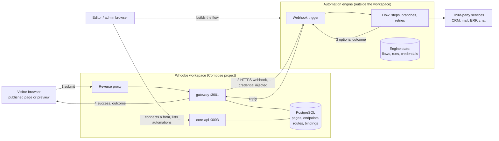
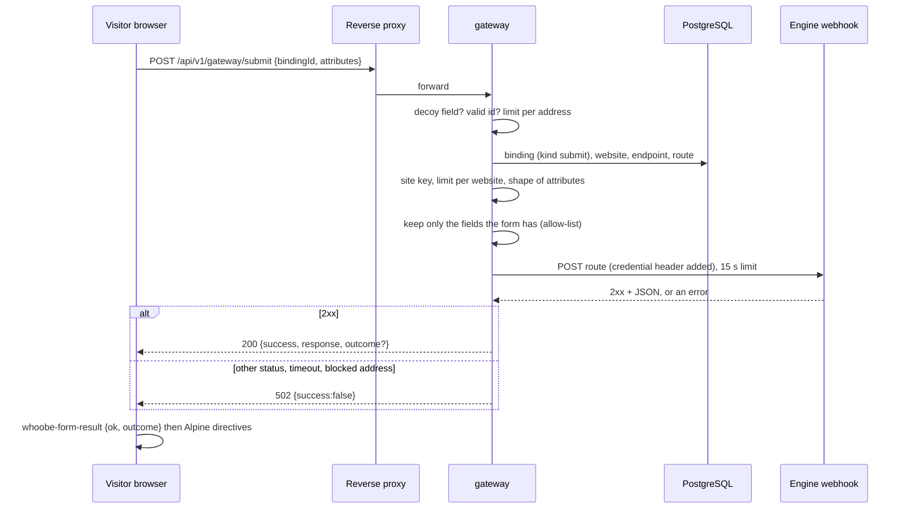

# Automations: how they relate to the architecture

For IT architects, DevOps and security reviewers. Read [architecture overview](../architecture/architecture-overview.md) first. This page says
where an *automation* sits in the system: what Whoobe does, what an external engine does, what travels between them, where the
state lives and which guarantees you get. The editor's view (setting a form up, the page reacting) is in
[`communication/marketing-automation.md`](marketing-automation.md).

An "automation" here is any process started by a form on a Whoobe page and carried out by a system outside Whoobe: a lead sent to a CRM,
an e-mail, a request routed for approval, a record created in an ERP, a notification to a chat. Marketing is the first use, not a
limit of the design.

## 1. The decision in one paragraph

**Whoobe does not execute automations.** It provides the *trigger* (a form on a page, a submission) and the *reaction surface* (the page
that shows something depending on the answer), and it keeps a *register* of which form is connected to which service. The
*engine* (Activepieces, n8n or anything that answers an HTTP webhook) runs the steps, holds the credentials of the services it calls and
keeps the run history. The reasons (cost of building durable execution and connectors, licence fit, security surface) are in
[`docs/plans/automations/why-no-custom-automation-engine.md`](https://github.com/swina/whoobe_project/blob/master/docs/plans/automations/why-no-custom-automation-engine.md).

## 2. Context

The engine is **not part of the workspace's Compose project** and the workspace does not start it. It is a separate system with its own
database and secrets, which the organisation runs next to Whoobe (same host in its own Compose project, another host, or the engine
vendor's hosted service). The only runtime link is the Gateway calling the engine's webhook.

## 3. Who does what

| Part | Responsibility in an automation | Does **not** do |
|---|---|---|
| **Page / form** (editor, stored in `pages` / snippets by core-api) | The form's settings (`formConfig`: target endpoint and route, optional name, popup on/off) and the AlpineJS directives that react to the answer, both stored in the page content | Run any logic of the flow |
| **core-api** | Saves the page; on save, the Gateway binding of the form is resolved (`gatewayBindingId`), and the public page content served to visitors carries only that id, not the endpoint or the route | Call the engine |
| **gateway** | Holds endpoints (base URL, encrypted credentials), routes and bindings; on a submission checks and forwards it, injects the credential, enforces the limits, extracts the `outcome` | Keep any state about a run; retry |
| **Engine** | Receives the webhook, runs the flow, calls third parties with *its own* credentials, answers the webhook, keeps the run history and the retries it offers | Know about Whoobe pages |
| **Visitor's browser** | Sends the form; receives `{ success, outcome }`; the form sends a `whoobe-form-result` event and the directives of the page decide what is shown | Receive anything from the engine other than the key |
| **Dashboard / editor** | The register: **Data & Communication > Automations** and the editor tool. Built on demand by scanning the saved pages and snippets (`collectAutomations` in `@whoobe-cms/schema`) | Show run status or the content of a flow |

## 4. One submission, step by step

Properties that matter for the design (taken from `apps/gateway/src/submit-handler.ts`):

- The browser names only a **binding id**. The endpoint, route and credential come from the database, resolved when the page was saved; a visitor cannot aim the Gateway at another URL.
- Only the **fields the form actually has** go to the engine (a visitor cannot add fields).
- The call is **synchronous with a 15 second limit**. Whoobe has no queue: the visitor's request waits for the engine's reply.
- Any non-2xx reply, a timeout or a blocked address becomes `502 Upstream rejected the submission`; the engine's error body is logged on the server and not sent to the visitor.
- On success the reply carries `outcome` (when the engine answered a plain key: 1 to 32 letters, digits, `_`, `-`) **and** `response`, the engine's whole reply (to be dropped in a later release; the flow must not put secrets or personal data in it).

## 5. State: where each thing lives

| State | Where | Notes |
|---|---|---|
| Form settings, Alpine directives | page / snippet content in PostgreSQL | versioned with the page |
| Endpoints, routes, bindings | PostgreSQL (`gateway_*` tables) | endpoint credentials encrypted at rest |
| Flows, runs, retries, the credentials of third parties | **the engine** (its own database or volume) | back it up and secure it separately; Whoobe's backups do not include it |
| The register of automations | **nowhere**: computed from the saved pages and snippets each time it is opened | cannot go stale, but shows only what is saved |
| Submission data | Whoobe keeps **none** for a Gateway form; it is forwarded | a form that targets a data class instead stores a Data Object |

## 6. Trust boundaries

| Crossing | Control |
|---|---|
| Visitor → Gateway | public route; limits (10 per 15 minutes per address, 300 per 15 minutes per website), optional per-website site key, decoy field, field allow-list, size and shape checks of the attributes ([API Gateway security](api-gateway-security.md)) |
| Gateway → engine | outbound HTTPS through `safeFetch` (SSRF guard: link-local and metadata always blocked; loopback and private ranges according to `OUTBOUND_ALLOW_LOOPBACK` / `OUTBOUND_ALLOW_PRIVATE`; `OUTBOUND_ALLOW_HOSTS` exempts a named internal host). An engine on the same host or a private address needs the matching setting (see [configuration reference](../operations/configuration-reference.md)); redirects are re-checked and credentials are not forwarded across origins |
| Engine → Whoobe's visitors | the reply is reduced to a validated key; the check is made in the Gateway and again in the browser. Hidden blocks are still in the page's HTML: this is experience, not access control |
| Engine → Whoobe (the other direction) | there is **no machine credential** in Whoobe ([authentication](../architecture/authentication-and-authorization.md), section 1): a flow that needs to read or write Whoobe uses the **public surface** (published content, public form submit) or a dedicated user account with a minimal role (a session). Do not give a flow an administrator account |
| Engine → third parties | the engine's own credentials; they never pass through Whoobe |
| Editor → engine | the engine's own login. Whoobe only links to its address (the *Service* link, `http(s)` only) |

## 7. Failure, retries and duplicates

Whoobe does not keep a record of a submission it forwards, so the guarantees come from the combination:

- **A slow flow.** If the engine takes longer than 15 seconds, the visitor gets a failure but the flow may still finish. A flow that
  does long work should answer the webhook **first** and continue afterwards (Activepieces and n8n can reply early); use the
  `outcome` only for decisions that are quick.
- **A retried submission.** A visitor who sees an error and submits again starts a second run. Make the flow **idempotent** where it
  matters (look up the contact before creating it; use the engine's own de-duplication).
- **An engine that is down.** The submission is lost to that visitor (502); Whoobe does not queue it. The offline queue of a generated
  PWA does not replay Gateway forms with their outcome.
- **Retries inside the flow** (a third party fails) are the engine's own and are visible in its run history, not in Whoobe.
- **Monitoring.** The Gateway logs the failures of forwarded submissions ([observability](../operations/observability-and-logging.md));
  watch the engine's own execution list for the rest.

## 8. Deployment

| Option | How | When |
|---|---|---|
| Same host, own Compose project | an engine of your choice, for example Activepieces as in the [example compose file](https://github.com/swina/whoobe_project/blob/master/examples/automation-engines/docker-compose.activepieces.yml) (not part of the Whoobe distribution; PostgreSQL, Redis, `127.0.0.1` only) behind its own HTTPS | one organisation, small installation; the Gateway reaches it on a private address or `localhost` (see the outbound policy above) |
| Separate host | the engine on its own machine, reached over HTTPS | separation of duties, heavier flows |
| Hosted by the engine vendor | the vendor's cloud | no engine to operate; credentials of third parties then live at the vendor |

The deployment model applies unchanged ([overview](../architecture/architecture-overview.md), section 7): **one workspace per organisation, so one engine per
organisation**. Do not share one engine between organisations: its credentials store holds the keys of every service its flows call.
The engine is outside the workspace, so [workspace scripts](../operations/creating-workspaces.md) do not create, update or back it up.

## 9. Beyond marketing

Anything a webhook can start is possible, with the constraints of this design (the trigger is a **form submission** and the answer is **one
key**):

| Use | Shape |
|---|---|
| Lead to CRM and thank-you page by segment | form → flow → HubSpot / Brevo; `outcome` picks the block |
| Internal request (leave, purchase) | form → flow → approval chat or ticket; `outcome` `received` |
| Order or enquiry to an ERP | form → flow → ERP API; `outcome` `accepted` / `needs_review` |
| Support request | form → flow → help-desk ticket and an e-mail |
| Data synchronisation | form → flow → several systems; or the flow reads the public content API on a schedule |

## 10. Not provided

- Other triggers (asset downloaded, page published, a schedule inside Whoobe). A flow can poll the public API; Whoobe does not emit events.
- Run history, status or retries inside Whoobe.
- Access to private content decided by an answer, or a verified e-mail address: the page only reacts to a word.
- A shared queue between the Gateway and the engine ([overview](../architecture/architecture-overview.md), section 4: there is no message queue).
- A Whoobe-side machine credential for flows.
