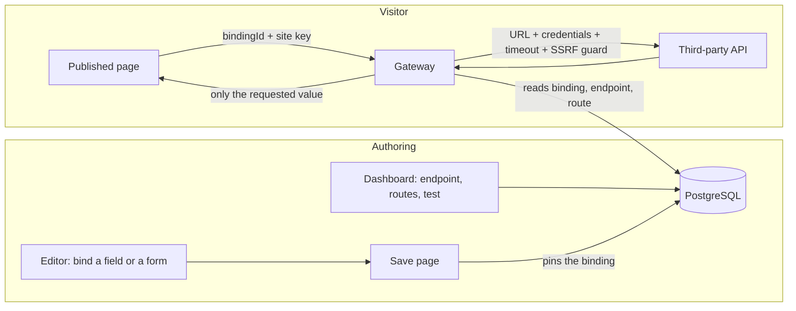

# Integrations (the API Gateway)

**Integrations** is the part of Whoobe that connects a website to other systems' APIs: a shop, a CRM, a mailing platform, an
automation engine, any service with a REST interface. You describe an API once, then show its data in pages and send forms to it,
without code and without ever putting a credential in a page.

In the dashboard it is called *Integrations*; in the code it is the **API Gateway** (`apps/gateway`, port 3001). This guide has
four parts: [what it is for](#1-what-it-is-for), [how to use it](#2-using-it), [how it works](#3-how-it-works-technical-notes) and [use from an application](#4-applications-that-call-whoobe-api-clients),
including its [limits](#5-limits-and-known-gaps). For credential protection in detail see
[API Gateway security](api-gateway-security.md).

## 1. What it is for

| You want to | How |
|---|---|
| Show a value from an API in a page (a price, a headline, a counter) | bind an element to a **field** of a route's reply |
| Show a list from an API (products, events, posts) | bind a container (a repeater) or a [table](../content/table-element.md) to an **array** in the reply, with filters; a list inside each item (products of a category) is a [nested binding](../content/nested-bindings.md) |
| Send what a visitor typed in a form to another system (create a contact, open a ticket) | set the form's target to a route (a `POST`, `PUT` or `PATCH`) |
| Start a flow in an automation engine and react to its answer | form to a webhook route, see [marketing automation](marketing-automation.md) |
| Push an email campaign draft to Brevo from a page or snippet | built-in preset, see [Brevo integration](brevo-integration.md) |
| Use a vendor API quickly | start from a **preset** (Brevo, Cloudinary, HubSpot, Mailchimp, Node-RED on this machine, Shopify, Stripe, a demo shop) |
| Use a documented API quickly | **import its OpenAPI / Swagger** file: the routes are created for you |

What makes it different from calling an API from the page:

- **Credentials stay on the server.** API key, bearer token, basic auth and OAuth2 client credentials are encrypted at rest
  (AES-256-GCM) and added by the gateway to the outgoing request. The browser, the editor's users and the published site never
  see them, and the dashboard never gets them back (editing is write-only).
- **A page cannot call anything it likes.** Saving a page *pins* each binding to one endpoint, route and set of filters. A visitor's
  browser can only ask for "binding X", never name a URL.
- **The editor sees real data.** A route is tested once; its reply is analysed and the fields (name, type, an example) are offered
  in the editor, which also shows the live value while you design.
- **One place to look.** Endpoints, routes and their schemas are listed in the dashboard; the pages that use them are listed in
  *Data bindings* (data from APIs and Data Objects) and *Automations* (forms that start a flow).

## 2. Using it

### 2.1 The pieces

| Piece | Meaning |
|---|---|
| **Endpoint** | an API: a name, a base URL, how to authenticate, a rate limit, a timeout, active or not |
| **Route** | one call on an endpoint: a method and a path, such as `GET products.json` or `POST contacts`. A `{name}` in the path is a parameter |
| **Schema** | the shape of a route's reply (fields and types), inferred from a real call. Offered in the editor as the list of fields |
| **Binding** | the link between an element of a page (or a form) and a route, with the field, the parameters and the filters |
| **Preset** | a ready-made endpoint for a known vendor: base URL, authentication fields and a few routes |
| **Site key** | an optional secret of one website, sent by its published pages with every request to the gateway |

### 2.2 Step by step: show data from an API

1. **Add the endpoint.** Dashboard, **Integrations > Add Endpoint**. Either pick a template (a preset) or type the **Name**, the
   **Base URL** and the **Auth Type**: *none*, *API key* (header name and value), *Bearer token*, *Basic* (user and password) or
   *OAuth2* (client ID, client secret, token URL, optional scope). The **Rate limit** is in requests per second.
2. **Add the routes.** *Add Route*: method, path (`products.json`, `customers/{id}`) and a description. Or **Import OpenAPI /
   Swagger** from a URL, or paste the spec (JSON or YAML) to create them all.
3. **Test the route.** The **Test & Infer Schema** button (the green one on the route) calls the real API, shows the reply and stores its **schema**. Do this for every
   route you will bind, and again when the API changes. *Send Request* does the same with parameters and a body of your choice,
   without touching the schema; *View Schema* shows what was inferred.
4. **Bind in the editor.** Open the page, the **Integrations** tab of the side panel lists endpoints, routes and fields. Drag a field onto
   an element (or select the element and click the field). The toolbar picker edits what is already bound: parameters, filters and
   the display transform. *Whole response* binds the entire reply (for a container that repeats over a list).
5. **Save the page.** Saving is what pins the binding to the route. A page that was not saved shows live data in the editor and
   nothing on the published site.
6. **Publish.** If the website has a site key, the published pages send it automatically (see 3.4).

Binding a list: bind the container to the array (for example the field `products`), then bind its children to fields of **one item**
(`title`, `price`, `images[0]`). Filters narrow the list, see 3.3.

Parameters: a route `customers/{id}` needs a value for `id`. Give it a fixed text, or `{id}` to take it from the address of the page
(a dynamic page such as `/customer/{id}`, see [dynamic website paths](../content/dynamic-website-paths.md)).

### 2.3 Presets

A preset fills the *Add Endpoint* form for a known service. The credentials are never part of a preset: you type your own.

| Preset | Base URL | Authentication | Starter routes |
|---|---|---|---|
| Brevo | `https://api.brevo.com/v3` | API key (header `api-key`) | list contacts, send a transactional email, create / list / send campaigns, list the contact lists |
| HubSpot | `https://api.hubapi.com` | Bearer | read and create contacts |
| Mailchimp | `https://api.mailchimp.com/3.0` | Bearer | the contacts of an audience |
| Shopify | `https://{shop}.myshopify.com/admin/api/2024-10` | API key | products, orders |
| Stripe | `https://api.stripe.com` | Bearer | customers, charges (read) |
| Cloudinary | `https://api.cloudinary.com/v1_1/{cloud_name}` | none (unsigned upload preset) | upload |
| Node-RED (this machine only) | `http://localhost:1880` | none | `POST whoobe-events`, the entry of the example flow; works only for a Node-RED on the same machine as the Gateway, see [Node-RED](node-red.md) |
| Fake Products | `https://dummyjson.com` | none | a demo shop, for trying the feature |

A `{placeholder}` in a base URL (`{shop}`, `{cloud_name}`) is yours to replace. Presets are plain JSON files in
`apps/gateway/presets/`; an installation adds its own or adapts one through `GATEWAY_PRESETS_PATH`, with no restart (format and rules:
`apps/gateway/presets/README.md`).

### 2.4 Forms that send data

A form whose target is a route sends its fields to the upstream API when the visitor submits. Rules the gateway enforces:

- Only the fields that **the form really has** are forwarded (the list is recorded when the page is saved), so a visitor cannot add
  fields such as a Brevo `listIds`.
- Values are checked for size and shape: at most 100 fields, plain field names, at most 20,000 characters per value.
- A value written as JSON (starting with `[` or `{`) is sent as a real array or object, since a browser form can only produce text.
- A hidden decoy field catches simple bots; such a submission looks successful and is dropped.
- The route must be a write method: a form is never bound to a `GET` route.
- For Brevo's *create contact*, fields that Brevo only accepts under `attributes` are moved there automatically.
- If the upstream answers `2xx`, the visitor sees success. Any other answer is a failure for the visitor (the reason is only in the server log).
- If the reply contains `"outcome": "<key>"` (letters, digits, `-`, `_`, up to 32), the page can react to it, see
  [marketing automation](marketing-automation.md).

## 3. How it works (technical notes)

### 3.1 The flow



- **Authoring.** An endpoint is a row with its credentials encrypted; a route belongs to an endpoint; a test stores the schema of
  a route and a sample reply (credential-shaped keys scrubbed). The editor reads schema and sample.
- **Save.** Saving a page (core-api) walks the content and writes one **binding** row per bound container, field or form: endpoint,
  route, field path, filters, the names of the parameters allowed, and its kind, `resolve` (read) or `submit` (write). The page keeps
  only an opaque `bindingId`; endpoint name, route path and filters are removed from the content sent to published sites.
- **Visit.** A published page is rendered by the renderer ([headless SDK](../content/headless-sdk.md)), which calls
  `POST /api/v1/gateway/resolve` with `{ bindingId, params }`, or `POST /api/v1/gateway/submit` with `{ bindingId, attributes }` for a
  form. The gateway looks up the binding and answers with the requested value only.

### 3.2 What the gateway does with a call

For a **resolve** (read):

1. rate limit per client address, before any database access;
2. the binding must exist, be of kind `resolve`, and, if the website has a site key, the key and website id must match the binding's
   own website (a binding id copied from another site does not work);
3. rate limit per website;
4. endpoint and route must still exist and the endpoint must be *active*;
5. only the parameters named when the binding was authored are used; every value is URL-encoded and `.` / `..` are refused;
6. credentials are added, the call is made (timeout 15 s, SSRF guard), the field path is applied to the JSON reply, then the filters;
7. the reply is `{ fieldPath, value, found }`. Nothing else crosses back, never a header.

A **submit** is the same with the checks of 2.4 added, and a different pair of limits.

### 3.3 Fields, lists, filters, display

- **Field path.** Dot notation with array indexes: `contacts[0].email`, `attributes.PHONE`, `images[0].url`.
- **Schema inference.** When a route is tested the reply is described as follows: every item of an array is read (up to 500) and the
  fields are the union of all of them, so a field missing from the first item is still found; a field that is absent or `null` in some
  items is marked *nullable*; the type and the example come from the first item that has a value; nested objects and arrays are handled
  the same way. A reply with an error status (`4xx`, `5xx`) is shown but **never replaces** a stored schema. Existing schemas keep
  their shape until the route is tested again.
- **Filters** (lists only): `eq`, `neq`, `in`, `contains` (case-insensitive), `gt`, `lt` on a field of one item. All filters must match
  (AND); there is no OR. `eq` and `neq` compare strictly, so a text `"5"` does not equal the number `5`; use `gt` / `lt` for numbers.
  They are applied in the gateway, so editor, preview and published sites always show the same result.
- **Display transform.** The format of a bound value (dates, numbers, text) is applied by the renderer on the page, not by the
  gateway. It is not sent to the gateway.

### 3.4 Who can call what

| Surface | Who | Protection |
|---|---|---|
| `/api/v1/gateway/endpoints`, `/routes`, `/test`, `/execute`, `/import-openapi`, `/preview-resolve`, `/plugins`, `/presets` | dashboard and editor users | session and the `gateway:manage` permission (`GATEWAY_MANAGE`) |
| `POST /api/v1/gateway/resolve`, `POST /api/v1/gateway/submit` | visitors of published sites | a valid **binding id**; optionally the site key; rate limits |
| `/api/remote/:endpoint/*` | signed-in users with `gateway:manage` | the way for a person to call a configured route directly, through plugins and the endpoint's rate limit |
| `/client/v1/*` | applications: a server with a key, a browser or an app with an identity provider token | the credential, scopes, limits and address rule; see 4 |
| `/api/internal/*`, `/dam/*` | the dashboard, to reach other Whoobe services | a valid session |
| `/public/*` | anyone | proxies core-api's own public routes, no gateway credentials involved |

**The site key.** A website can have a Gateway site key (**Publish > Gateway site key**, optional, shown once, stored as a salted hash). Published
pages send it as `X-Whoobe-Site-Id` and `X-Whoobe-Site-Key`; a generated site takes it from `CMS_SITE_API_KEY`. A website with no key
relies on the binding id alone. The key is a second layer; it is not a login for people.

### 3.5 Limits and protections applied

| What | Value | Scope |
|---|---|---|
| Reads (`resolve`) per client address | 120 per minute | each address |
| Reads per website | 1,200 per minute | each website |
| Submissions per client address | 10 per 15 minutes | each address |
| Submissions per website | 300 per 15 minutes | each website |
| Upstream timeout, resolve / submit / test | 15 seconds | each call |
| Upstream timeout, `/api/remote` | the endpoint's own timeout (default `GATEWAY_PROXY_TIMEOUT_MS`, 30 s) | each call |
| Endpoint rate limit (requests per second) | the endpoint's value, else `GATEWAY_DEFAULT_RATE_LIMIT_RPS` (10) | `/api/remote` only |
| Submitted fields | 100 per form, 64 characters per name, 20,000 per value | each submission |
| OpenAPI spec | 10 MB, 20 s, external `$ref` not followed | each import |

The counters of the public limits above are kept in the memory of the gateway process; those of API clients and of the endpoint limit can be shared (4.4).

Every outgoing call (routes, OAuth token requests, OpenAPI download) goes through the SSRF guard: addresses of the cloud metadata
service, link-local, unspecified and reserved ranges are refused; loopback is refused in production; private ranges (RFC 1918) are
allowed unless `OUTBOUND_ALLOW_PRIVATE=false`, which an installation reachable from the internet should set
([threat model](../security/threat-model.md)).

Errors: the real cause is written to the gateway log; the caller gets a short fixed message (`502`, `Resolution failed`,
`Upstream rejected the submission`). An upstream URL, host name or key can therefore not leak through an error.

### 3.6 OAuth2

Only the **client credentials** grant is supported: the gateway posts `client_id`, `client_secret` and optionally `scope` to the
*Token URL*, keeps the token (with its expiry) in the database and renews it a minute before it expires. There is no sign-in
screen, no refresh-token flow, and no retry after a `401`: if a token is revoked early the next call fails until it expires.

### 3.7 Plugins

A plugin is code added by the operator, for what a preset and a route cannot express: extra routes of its own under `/api/remote/`,
and request and response hooks that can change the outgoing URL, headers and body, or the reply. Put the `.js` or `.ts` file in the
folder named by `GATEWAY_PLUGINS_PATH` and **restart the gateway**; the **Integration Plugins** page lists what is loaded. Plugin hooks
run for calls made through `/api/remote/`; the public `resolve` and `submit` paths do not run them. A plugin runs with the full
privileges of the gateway process: install only code you have read.

## 4. Applications that call Whoobe (API clients)

> The complete reference, with code examples, errors and troubleshooting, is the [API clients guide](api-clients.md). This section is the short version.

The routes you configure can also be used **by an application outside Whoobe**: a mobile app, a back-end, another company's system.
It authenticates with a **key** (a server) or with a **token of your identity provider** (a browser or an app), never with a user
account in Whoobe (Whoobe stores no users for it), and sees only what you allow. The
credentials of the third-party services stay in Whoobe; the application never receives them.

### 4.1 Set up a client

1. **API clients** in the dashboard (Data & Communication) > **New client**. The editor opens in its own tab, with sections General,
   Authentication, Limits and *What this client may call*.
2. **Name**, and **how it proves who it is**:
   - *A key* (server to server): a static key that a **server** keeps (a back-end, a job, another system). Never put it in a web
     page or a mobile app: anyone can read it there. A request that carries a key and comes from a browser is refused (`403`).
   - *Identity provider token* (browser, app): the application signs in with your identity system (Keycloak, Entra ID, Cognito,
     Auth0...) and sends its **access token**. Whoobe checks it against the provider; there is no secret to keep or leak, see 4.7.
3. **What this client may call:** choose an API from **Add an API...** (an Integrations endpoint, or *Data Objects*), then tick its routes
   (or classes). *all routes* gives every route of the endpoint, any method,
   including routes added later: use it only for a client you fully trust.
4. **Limits:** requests per second, an optional daily quota, optional allowed addresses (`203.0.113.5`, `10.0.0.0/8`), an optional expiry.
5. **Create.** For a key client the key is shown **once**: copy it into the server's configuration. A token client has nothing to copy.

To change a key without a gap: **add a key** to the client, move the application to it, then **revoke** the old one. *Suspend*
stops every key of a client at once.

### 4.2 Call

```bash
curl -H "Authorization: Bearer wbk_..." \
  "https://<host>/client/v1/gateway/Shop/customers/42?expand=orders"       # a server, with its key
curl -H "Authorization: Bearer eyJhbGciOi..." \
  "https://<host>/client/v1/gateway/Shop/orders.json"                       # an app, with the access token of the identity provider
curl -X POST -H "X-Whoobe-Key: wbk_..." -H "Content-Type: application/json" -d '{"email":"a@b.c"}' \
  "https://<host>/client/v1/gateway/Crm/contacts"
curl -H "Authorization: Bearer wbk_..." "https://<host>/client/v1/me"
```

The address is `/client/v1/gateway/<endpoint name>/<route path>`: the path is matched to a configured route (`customers/{id}`
takes `42`), the query string and a JSON body (up to 1 MB) are passed on, the gateway adds the credentials and returns the service's
status and body. Only JSON and text replies are relayed; a header is passed on only if it is on the allow-list (`content-type`,
`cache-control`, `etag`, `last-modified`, `date`, `x-request-id`).

| Answer | Meaning |
|---|---|
| `200`..`4xx` | what the service answered |
| `401` | no credential, or a wrong, revoked or expired key, or a token that is not valid for this client (wrong signature, issuer, audience, expired...), or a suspended client. All the same message; the reason is only in the server log |
| `403` | the credential cannot be used from this address; a key was sent by a browser; or the token is valid but its claims give no access |
| `404 Not found` | the endpoint or the route does not exist **or is outside the client's scopes**. The same answer for both, so a client cannot learn what else exists |
| `400` | a path with an empty or relative segment (`..`, `//`) |
| `413` / `415` | body over 1 MB / not JSON |
| `429` | over the requests-per-second limit, the daily quota, or after 20 failed keys from one address. `Retry-After` says when |
| `502` | the service could not be reached, or answered with a `5xx` (its body is not relayed) |

`RateLimit-Limit` and `RateLimit-Remaining` are on every answer.

### 4.3 Scopes

A scope is one text: `gateway:call:<endpoint name>:<METHOD or *>:<route>`.

| Scope | Allows |
|---|---|
| `gateway:call:Shop:GET:orders.json` | that route |
| `gateway:call:Shop:GET:customers/{id}` | a route with a parameter |
| `gateway:call:Shop:GET:customers/*` | every route whose path starts with `customers/` |
| `gateway:call:Shop:*:*` | every route of the endpoint, any method |

The scope is checked against **the route the path was matched to**, never against the raw path. The endpoint is named, never a
wildcard, and it cannot contain a `:`. If you rename an endpoint its scopes stop matching until you edit the client (it fails
closed). Two equally specific routes (`products/{id}` and `products/{name}`) are resolved among those the client may call.

#### Data Objects

`data:read:<Class name>` lets the client read the **published** objects of one Data Class (`data:read:*` all classes, including later
ones; the dashboard warns). The class is named exactly; there is no pattern.

| Call | Answers |
|---|---|
| `GET /client/v1/data/Blog` | `{ class, objects: [...], limit, offset }` |
| `GET /client/v1/data/Blog/<id>` | `{ object }` |

Query parameters of the list: `filter=field:operator:value` (repeat, up to 5; operators `eq`, `neq`, `contains`, `gt`, `lt`),
`orderBy=field` with `dir=asc|desc`, `limit` (1-100, default 50), `offset`, `locale`. A field is one of the class's own fields, or `key`,
`locale`, `updatedAt`. An object carries `id`, `key`, `locale`, `translationGroupId`, `publishedAt`, `updatedAt` and `attributes`
(only the fields the class defines). Drafts never appear, and a draft, an unknown class, a class outside the scopes and the id of an
object of another class all answer the same `404`. Relations are returned as ids and asset fields as references; they are not
expanded.

### 4.4 Where the counters live

The per-second limit and the daily quota are counted in the gateway's memory by default: correct for one process. With several gateway
processes, or to keep the counts across a restart of the gateway, use a shared store, **Valkey** (a BSD-licensed Redis fork; any
Redis-protocol server works):

1. `COMPOSE_PROFILES=local-s3,ratelimit` in the env file starts the `valkey` service (no published port, password, nothing on disk).
   `provision-workspace.sh` has already generated `VALKEY_PASSWORD` and `GATEWAY_REDIS_URL`.
2. Set `GATEWAY_RATE_LIMIT_BACKEND=redis` and restart the gateway.
3. `GET /health` shows `rateLimit: { backend: "redis", degraded: false }`. If the store goes down the gateway keeps serving, counts in
   its own memory, logs a warning, and reports `degraded: true`.

The same store serves the per-endpoint limit of `/api/remote`. The limits of the public `resolve` and `submit` (3.5) stay in the process.

### 4.5 Development and production

Use two workspaces, one for development and one for production, each with its own clients and keys; the application changes a base
URL and a key. The credentials of third-party services are entered separately in each (a sandbox account in development). For files,
the CDN mirror of assets is a separate feature of the asset manager.

### 4.6 What it does not do (yet)

- **Data objects** are readable (4.3), not writable; **assets** are not yet on `/client/v1`.
- **Binary replies, multipart bodies and streaming** are not relayed.
- **A key from a browser** is refused (`403`) when the request carries an `Origin` header, and logged. A script can leave the header out,
  so also set the client's allowed addresses: they are the real control.

### 4.7 Identity provider tokens (browsers and apps)

A token client is the **registration of an application with your identity provider**. It holds no secret.

| Setting | Meaning |
|---|---|
| Issuer | the `iss` of the tokens, exactly as the provider writes it (Auth0 ends it with `/`, Keycloak and Entra do not). `https`; plain `http` only outside production, for a local provider |
| Audience | the `aud` the tokens must carry: the value you configured at the provider for this API |
| Signing algorithms | `RS256` and `ES256` by default; `PS*`, `ES384/512`, `EdDSA` can be added. `HS256` and `none` are never accepted |
| Keys address (JWKS) | optional: otherwise read from the issuer's discovery document (`/.well-known/openid-configuration`), which must name the same issuer |
| Authorized party | optional: the `azp` (or `client_id`) the token must carry, so a token made for another application of the same provider is refused |
| The token must carry | optional claims, all required (for example `groups` = `staff`) |
| What each kind of user may call | optional rules: *if the claim has this value, the user gets these routes*. Without rules every valid token gets all the client's routes; with rules a user gets the union of the matching ones, and a user who matches none is refused (`403`). Rules never reach beyond the routes ticked for the client |
| Requests per second, per user | each `sub` is limited on its own, inside the client's limit (default 5) |

What Whoobe checks on each call: the token's size and shape, the algorithm against the list, the signature with a key of the provider
(cached 10 minutes; if a token names an unknown key id the keys are read again, at most every 30 seconds), `iss`, `aud`, `exp` (required),
`nbf`, `sub` (required) and `azp` when set. Clock difference up to 60 seconds is tolerated. The keys and the discovery document are
fetched through the outbound guard (4.4 and 3.5). Signing in, refreshing the token and logging out are the identity provider's job;
Whoobe never sees a password or a refresh token and creates no user. The token's `sub` appears in the log line of each call.

Browsers may call `/client/v1` directly with the token (cross-origin calls are allowed, without cookies).

**Setting it up with Keycloak** (tested):

1. In the realm, create the roles that will separate your users (for example `orders-reader`, `orders-admin`) and give them to the users.
2. Create a client for the application (public client for a browser or mobile app, with the standard flow and PKCE; for tests, *direct access grants*).
3. On that client add a mapper *Audience* with the custom audience `whoobe-api` (added to the access token). Without it the token's `aud` is only `account`.
4. In Whoobe: **API clients > New client > Identity provider token**. Issuer `https://<keycloak>/realms/<realm>`, audience `whoobe-api`,
   authorized party the client's id, and rules such as `realm_access.roles` = `orders-reader` giving the read routes and
   `orders-admin` giving all of them.
5. The application sends `Authorization: Bearer <access token>`.

**Entra ID, Cognito and Auth0** issue JWT access tokens too and work the same way; this has been checked against Keycloak only. Where
the values come from: *Entra ID* issuer `https://login.microsoftonline.com/<tenant>/v2.0`, audience the application ID URI or client id
of the API registration, roles in the `roles` claim (app roles) or `groups`. *Cognito* issuer
`https://cognito-idp.<region>.amazonaws.com/<pool id>`, audience the app client id (ID tokens) or use access tokens whose audience is
`client_id` (set the authorized party), groups in `cognito:groups`. *Auth0* issuer `https://<tenant>.auth0.com/` (with the slash),
audience the API identifier, permissions in `permissions` or `scope`. Opaque (non-JWT) access tokens are not supported.

## 5. Limits and known gaps

- **Reading is `GET` only.** A binding that reads data must point to a `GET` route. Submitting uses `POST`, `PUT` or `PATCH`.
- **One reply per binding.** The gateway does not follow pagination (`next` links, cursors): a bound list shows what the one call
  returns.
- **No caching.** Each render of a page calls the upstream again. For an API with quotas, limit the number of bindings or publish
  statically. The gateway's limits above protect Whoobe, not the third party's quota.
- **Authentication.** A request that must be signed per call (Cloudinary signed uploads, AWS style signatures) cannot be expressed;
  use an unsigned or token-based form of that API, or a plugin.
- **Rate counters.** By default they are per process. With a shared store (4.4) the API client limits and the endpoint limit are
  shared between processes; the public `resolve` and `submit` limits are still per process. See the
  [configuration reference](../operations/configuration-reference.md).
- **The endpoint's rate limit does not apply to `resolve` and `submit`**, which have the address and website limits of 3.5.
- **Credential key.** `GATEWAY_AUTH_ENCRYPTION_KEY` lives in the process environment and there is no rotation tool yet; details and
  the other open points in [API Gateway security](api-gateway-security.md).
- **A bound page copy does not follow the snippet it came from.** Inserting a snippet copies it; changing the snippet later does not
  change the pages. The *Data bindings* list shows which snippet a block came from.
- **A schema is a snapshot.** If the API changes its reply, test the route again; until then the editor offers the old fields.

## 6. When something does not work

| Symptom | Likely cause |
|---|---|
| The editor shows data, the published page shows nothing | the page was not saved after binding; the website has a site key and the published site does not send it (`CMS_SITE_API_KEY`); the endpoint or route was deleted or the endpoint is not active |
| The Integrations tab says *No schema yet* | the route was never tested: **Test & Infer Schema** |
| A field exists in the API but is not in the list | test the route again (older schemas were built from the first item only); the field first appears after the 500th item |
| Test shows an error status and the schema did not change | by design: an error reply never replaces a good schema. Fix the credentials or the URL |
| `401` or `403` from the upstream | wrong or expired credential; header name is case-sensitive for some APIs (Brevo: `api-key`); OAuth2: wrong token URL or scope |
| A list shows too much or too little | filters are AND only; `eq` on a number typed as text; the parameter `{id}` has no value on the page |
| A form says it failed, the service received nothing | the route is not a write method; the field is not in the form's recorded list (save the page again); the upstream refused (see the gateway log) |
| `429` | the address or website limit of 3.5 was reached; for an application, its own limit or quota (4.2) |
| `Gateway resolve failed: 401` while publishing a site | the site key is missing in the build environment; see [website publishing](../content/publishing/website-publishing.md) |
| The container of a generated site cannot reach the API | the gateway address (`GATEWAY_URL`) must be reachable **from the container**, not just from your browser |

## 7. Related documents

- [API Gateway security](api-gateway-security.md): encryption at rest, redaction, error handling, what is deferred.
- [Marketing automation](marketing-automation.md): forms that start a flow in Activepieces or n8n.
- [Brevo integration](brevo-integration.md): the preset and the campaign draft.
- [Table element](../content/table-element.md): tables bound to an API list.
- [Headless SDK](../content/headless-sdk.md): how a published site resolves bindings.
- [Configuration reference](../operations/configuration-reference.md): every `GATEWAY_*` variable.
- [Architecture overview](../architecture/architecture-overview.md) and [automations](automations-architecture.md).
- [API reference](../api/api-reference.md): the gateway routes.

## A data binding reads GET routes only

A binding (a list, a text, a table) is resolved with a **GET**. The route of a webhook (`POST /webhook/...` of Activepieces or n8n) or any write route is not offered in the Gateway panel and the binding picker, and the editor's preview refuses it at once with the reason. Use such a route from the **Form settings** (a form that starts the flow) or as an [automation](marketing-automation.md). A GET to a webhook that answers when its flow ends would otherwise wait until the timeout (15 s) and fail with `502`.

