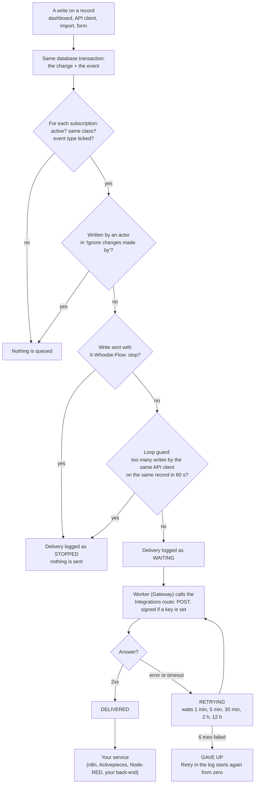
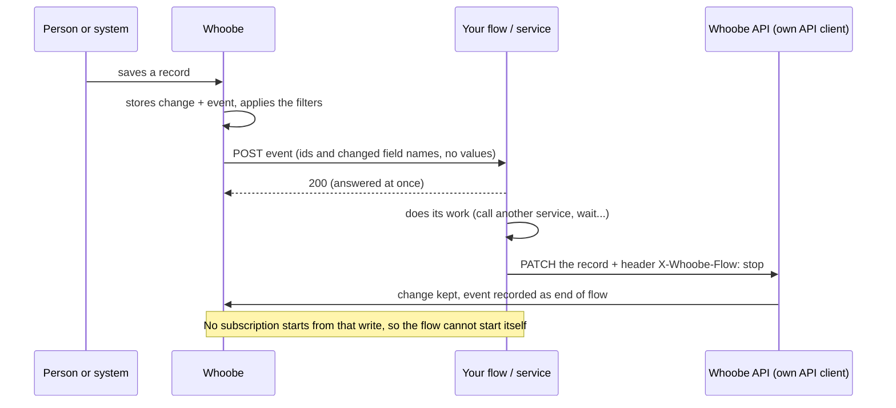
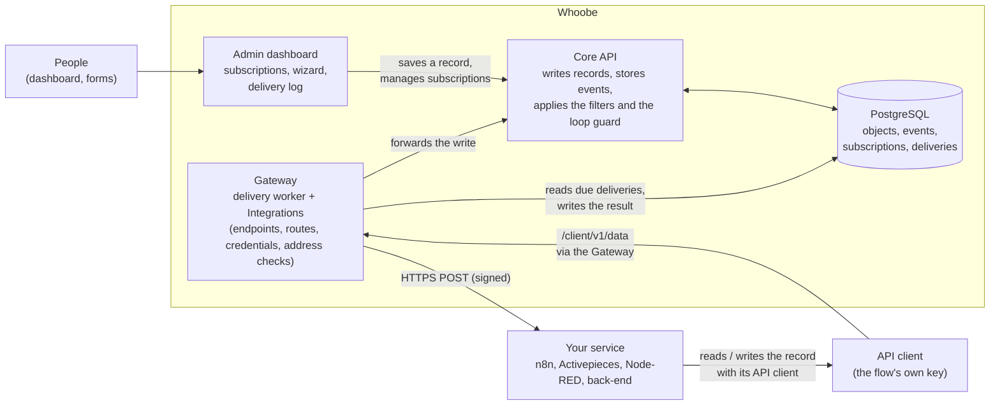

# Object events: tell another system when a record changes

> **Not in the v0.1.0 tag.** This is on `master` and will be in the next release; an installation of v0.1.0 does not have it.

A **subscription** makes Whoobe send a small message (an *event*) to an external service whenever a Data Object of a class is created, changed,
published, unpublished, moved in its workflow or deleted. The service can be an automation engine (Activepieces, n8n), a back-end of yours or
anything that accepts an HTTPS `POST`. Whoobe does not run the automation: it tells the service that something happened, and the service
decides what to do. For the reasoning see [Why no engine of our own](../architecture/design-decisions/no-automation-engine-of-our-own.md).

Typical uses: a new Contact goes to the CRM flow, a published Blog post triggers a rebuild or a chat message, an order record starts a
fulfilment flow, a deleted record is removed from a search index.

**In the dashboard:** *Data & Communication > Object events*. Only users with the permission **`object_events:manage`** (the `admin` role by default)
see the entry and can use it. It is switched off in the public sandbox.

## How the flow works

Whoobe stores the event in the same transaction as the change, decides for each subscription whether to send it, and a worker delivers it through the
Integrations gateway. What the service does with it is up to the service.



A flow that writes the answer back into the record closes the circle. This is where the loop protections of section 5 apply:



### Who does what



| Component | Role in the flow |
|---|---|
| **Admin dashboard** | Where people edit records, create subscriptions (wizard or form) and read the delivery log. It never sends events itself. |
| **Core API** (`apps/core-api`, `packages/core`) | Applies every write to a record and, in the same transaction, stores the event and one delivery per matching subscription (class, event type, ignore list, `X-Whoobe-Flow: stop`, loop guard). Also serves the subscription and delivery-log endpoints. |
| **PostgreSQL** | Holds the records, the events, the subscriptions and the deliveries with their status, tries and next attempt. The queue is a table: no separate broker. |
| **Gateway** (`apps/gateway`) | Runs the **delivery worker**: picks the deliveries that are due, builds the call from the subscription's Integrations endpoint and route (credentials, address checks, signature), sends it, and records the outcome and the next try. It is also the entry for the flow's API client (`/client/v1/...`). |
| **Integrations** (endpoints and routes) | Say *where* the call goes. Created by hand or by the wizard; edited in their own screens. |
| **API client** | The flow's own identity and key for reading and writing records. Its id goes in the ignore list, and its writes should carry `X-Whoobe-Flow: stop`. |
| **Your service** | Not part of Whoobe. Receives the event, does its work, may call back. Whoobe does not choose or ship it. |

The log of each subscription (section 3) shows every step above as a status. The event never carries field values; the service reads them from the API.

## 1. What the service receives

An HTTPS `POST` with a JSON body and these headers:

| Header | Meaning |
|---|---|
| `X-Whoobe-Event-Id` | The id of the event. **Use it as an idempotency key**: delivery is *at least once*, so the same event can arrive twice. |
| `X-Whoobe-Event-Type` | e.g. `object.updated` |
| `X-Whoobe-Timestamp` | Seconds since 1970 when the call was made. |
| `X-Whoobe-Signature` | Only when the subscription has a signing key: `sha256=` and the HMAC (see section 4). |

```json
{
  "id": "c1d2…", "type": "object.updated", "occurredAt": "2026-10-16T10:50:12.000Z", "instance": "dashboard.example.com",
  "class":  { "id": "3e7e103d-…", "name": "Contact" },
  "object": { "id": "…", "translationGroupId": "…", "locale": "en", "key": "ada-lovelace", "published": false, "workflowState": null, "updatedAt": "…" },
  "changed": ["company"],
  "actor": { "type": "user", "id": "…" }
}
```

**The event never carries the values of the fields**, only their *names* in `changed` (and the key, path or parent when those changed). A service
that needs the values reads the record through the API with its own [API client](api-clients.md). This keeps personal data from leaving Whoobe
by mistake and keeps the message small. Files travel as references, never as bytes.

| Event type | When | Extra |
|---|---|---|
| `object.created` | a record is inserted | one event per language row (a record in two languages gives two events with the same `translationGroupId`) |
| `object.updated` | its fields, key, path or parent changed | a change that only publishes or unpublishes is *not* an update |
| `object.published` / `object.unpublished` | `published` changed | |
| `object.transitioned` | its workflow state changed | `transition: { "from": …, "to": … }` |
| `object.deleted` | a record was deleted | the object part describes the row as it was |
| `object.bulk` | an import, "Empty data" or a migration | **one** summary: `bulk: { kind, count, firstIds }` (up to 10 ids), never one event per row |

One save can produce several events (for example an update that also publishes): they are sent separately. A save that changes nothing sends nothing.
When a language is added to a record, the other languages' shared (non-localized) fields are brought in line and each of those rows sends its own
`object.updated`, with the actor `system`.

`actor.type` is `user` (someone in the dashboard), `api-client` (an application with a key or token), `import` (a bundle or migration) or
`system` (Whoobe itself, including a public form).

## 2. Create a subscription

### The quick way: *Connect a flow*

*Object events > Connect a flow* asks four things and does the rest:

1. **What happens in Whoobe**: the class, and *created*, *changed* and/or *published or taken down* (more events under *More events*). "Changed"
   means a field changed: saving without a change, or only publishing, is not a change.
2. **Where is the flow**: paste the **webhook URL** your engine shows for the flow's trigger. Whoobe recognises Activepieces and n8n URLs, creates the
   Integrations endpoint (or reuses the one with the same address) and the **POST** routes, and, for those two engines, both the *live* and the *test*
   address (the test address answers only while the engine's editor is waiting for a sample). Choose which one the subscription uses; it can be switched
   later from the list (a **TEST / LIVE** badge and a "switch" button). For any other engine paste its URL; a second URL for its test mode is optional.
3. **Does the flow write back to the record?** If yes, choose **a new API client** (Whoobe creates one that can read and write **drafts of that class only** and
   shows its **key once**) or **an existing one** (the list offers the active key clients that may write that class; nothing is created and no key is shown, the
   flow must already have it: useful when one engine runs several flows with one key). Either way the client goes in the subscription's *ignore changes made by*
   list, so the flow does not start itself again, and you get the block to paste into the engine's HTTP step (method `PATCH`, the URL with the record id, the
   headers and a body example).
4. **Test**: *Send a test event* waits a few seconds and says in words what came back (received; the engine is not listening; the flow is not published;
   the host cannot be found; and so on). The engine's answer itself is never stored.

If a step fails, what the attempt had created is removed again and the dialog says what could not be. The wizard needs the permissions
`object_events:manage` and `gateway:manage`; without the second one use the normal way below. Everything it creates is an ordinary endpoint, route,
subscription and API client, editable in their own screens. Whoobe does not prefer an engine and does not ship one: the wizard only knows two URL shapes.

### The normal way, step by step

1. In **Integrations**, create an *endpoint* for the service (its base URL and credentials) and, under it, a *route* that is **POST, PUT or PATCH** with a
   **fixed path** (no `{parameters}`), for example `/api/v1/webhooks/<flow id>` on Activepieces. The call uses the endpoint's credentials and the
   Gateway's address checks (see [Integrations](integrations.md)).
2. *Object events > New subscription*:
   - **Name**: any label, unique.
   - **Class**: one class, or *Every class*.
   - **Events**: tick what should be sent.
   - **Integrations endpoint and route**: where to send it.
   - **Active**: untick to pause. A paused subscription queues nothing.
3. Use **Send a test event** (the paper-plane button). A synthetic `object.updated` marked `"test": true` is sent to that subscription only,
   whatever its filters; its object id is all zeros. The delivery log shows how it went.

A subscription only receives events from the moment it exists. Changes made before are not replayed.

## 3. The delivery log

Open it with the checklist button: it opens in its own tab, titled with the subscription's name. Each row is one event for this subscription, with its date and time:

| Status | Meaning |
|---|---|
| *waiting* | queued, not tried yet (a few seconds at most) |
| *delivered* | the service answered with a `2xx` status |
| *retrying* | the last try failed (network error, timeout of 10 seconds, or a non-`2xx` answer); the next try is shown |
| *gave up* | six tries failed. Use **Retry** to start again from zero |
| *stopped* | Whoobe **chose not to send it**, and says why in the last column: the write carried `X-Whoobe-Flow: stop`, or the loop guard fired (section 5). It is never sent and has no Retry |

The waits between tries are **1 minute, 5 minutes, 30 minutes, 2 hours, 12 hours**. The log shows the last problem as a short text (for example
`the consumer answered HTTP 503`). **It never shows the content of the event or the service's answer**: the answer is read and discarded.

If a service is down for a long time, deliveries pile up as *retrying* and become *gave up* one by one; nothing is lost silently, and each can be
retried. Deleting the subscription deletes its log and cancels what was waiting.

To keep the log short, filter it (status, event, record id, how many rows) and delete rows: tick the finished ones (*delivered*, *gave up*, *stopped*)
and choose **Delete selected**, or filter on one of those statuses and choose **Clear all**. A row still *waiting* or *retrying* cannot be deleted. Deleting
log rows does not touch the events themselves or the loop guard's counts.

## 4. Signature (optional)

To let the service check that a call really comes from your Whoobe, give the subscription a **signing key name** (*Advanced*): the **name of an
environment variable of the Gateway**, which must start with `OBJECT_EVENTS_SECRET_` (for example `OBJECT_EVENTS_SECRET_CRM`). Put the secret itself in that
variable (the server environment or `.env`, never in the dashboard) and restart the Gateway. If the variable is missing the delivery fails with a clear
message and nothing is sent, so a typo cannot send unsigned calls.

The service computes `HMAC-SHA256(secret, timestamp + "." + body)` with the **exact body text** it received, compares it with the header (in constant time)
and refuses a timestamp older than 5 minutes.

## 5. Stop a loop

**The first line of defence: send `X-Whoobe-Flow: stop` on the flow's write.** An [API client](api-clients.md) that writes a record (`POST` or `PATCH /client/v1/data/...`)
can add the header `X-Whoobe-Flow: stop`. It means *this write is the result of a flow*: Whoobe keeps the change and the event in its audit trail (marked
`endOfFlow`), but **starts no subscription because of it**. So a flow that receives an event, calls an external service, waits for the answer and writes the
answer into the record cannot start itself, whatever the subscriptions say. The wizard's Node-RED script and HTTP-step block already include it. Any other value, or no header, is an
ordinary write.

**The second: the loop guard** (a safety net for flows that do not send it). Whoobe counts the events written by one **API client** on one **record**: from the
6th within 60 seconds on, the delivery is not sent; it is listed in the delivery log as *stopped* with the reason, the subscription shows a violet **loop guard**
badge for a day, and one line goes to the log. A second counter per subscription and record (more than 12 events by API clients in 60 seconds) catches two flows that
answer each other. People are never counted, nor the system or imports: several people, or a person and a flow, editing one record together are not stopped, and
different clients are counted separately. The numbers can be changed in the environment: `OBJECT_EVENTS_LOOP_MAX` (5; `0` switches this counter off),
`OBJECT_EVENTS_LOOP_SUB_MAX` (12; `0` off) and `OBJECT_EVENTS_LOOP_WINDOW_SECONDS` (60). A write that carries `X-Whoobe-Flow: stop` is not counted.

**The third: the ignore list.**
If the automation writes back into Whoobe (for example it sets a field to `synced`), that write is itself a change and would start the automation again.
Give the automation its own API client and list that client's id under **Ignore changes made by**: changes made by an actor in that list are not sent
to this subscription. Two more safety nets: pause the subscription, or set `OBJECT_EVENTS_ENABLED=0` for the whole instance.

**Two automations on the same class can start each other.** Each one ignores only its own client, so the write of the first is a change for the second, whose
write is a change for the first, and so on. This was seen in practice with two connections on one class. List the API clients of **every** automation that
writes to that class in each subscription's *Ignore changes made by*, or keep each class to one writer.

## 6. Good to know

- **At least once, not exactly once.** Make the service idempotent on `X-Whoobe-Event-Id`. For a payment-like step use a service built for it.
- **Order** is not guaranteed across records; for one record, compare `occurredAt` and the object's `updatedAt`.
- **Large imports** send one `object.bulk`, not one event per row. A flow that needs each record reads the class through the API after it.
- **A service on the same machine or network**: the Gateway refuses loopback addresses in production. Set `OUTBOUND_ALLOW_HOSTS=<host name of the service>`
  for that one host (see [Integrations](integrations.md)). Private ranges are open unless `OUTBOUND_ALLOW_PRIVATE=false`.
- **Worker settings** (Gateway environment): `OBJECT_EVENTS_ENABLED=0` stops the delivery worker and the creation of events; `OBJECT_EVENTS_CONCURRENCY`
  (default 5) is how many calls are made at once.
- **Transactions**: the event is stored in the same database transaction as the change. If the change is rolled back there is no event; if the event
  cannot be stored the change is not saved.
- **Keep secrets out of the route path.** A route's path and an endpoint's base URL are stored as plain text and are visible to everyone who can manage
  the Gateway (and are in database backups); an endpoint's *credentials* are stored encrypted. If an engine's webhook needs a secret, prefer an
  authentication the endpoint can hold (key or bearer token); if the engine puts the secret in the URL, treat that route as sensitive.
- **Node-RED** has its own page, [Node-RED with Whoobe](node-red.md): a ready preset, the wizard's script that writes back, and how to develop a flow locally and run it unexposed.
- **Any engine, your choice.** Whoobe sends an HTTP call and nothing more, so it does not prefer or exclude any automation engine (Activepieces,
  n8n, Make, a script of yours). The engine is **not part of Whoobe**: choosing it, installing it, making it reachable from the Gateway and
  respecting its licence are the operator's own responsibility. The examples use Activepieces only because it is what the documentation was tried with.
- **No code runs inside Whoobe**: a subscription chooses what is sent and where, nothing else. Anything that must run your own code belongs in your own
  service, which receives the event and calls Whoobe back with an API client.

## 7. Example: Activepieces

1. A flow with the trigger **Catch Webhook** and an action **Return Response** (status 200); publish it and copy the *live* URL
   (`http://localhost:8090/api/v1/webhooks/<flow id>`).
2. In Integrations: endpoint `activepieces` with base URL `http://localhost:8090`, route `POST /api/v1/webhooks/<flow id>`.
3. A subscription on the class, events *Created* and *Updated*, that endpoint and route; **Send a test event**; the flow shows a run.

The same steps can be done through the API (section 8).

## 8. For developers: the API

All routes need `object_events:manage`. See the [API reference](../api/api-reference.md) for the list;
a subscription is `{ name, enabled, classId | null, events[], endpointId, routeId, ignoreActors[], signingSecretRef | null }` and the payload mode is
`minimal` (no attribute values).
